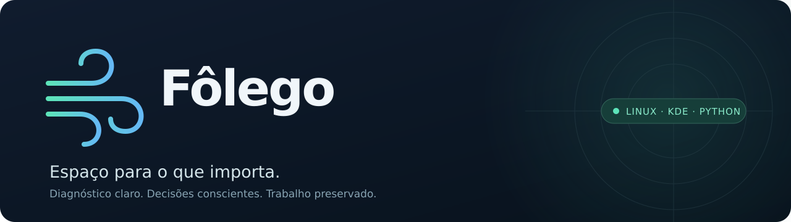
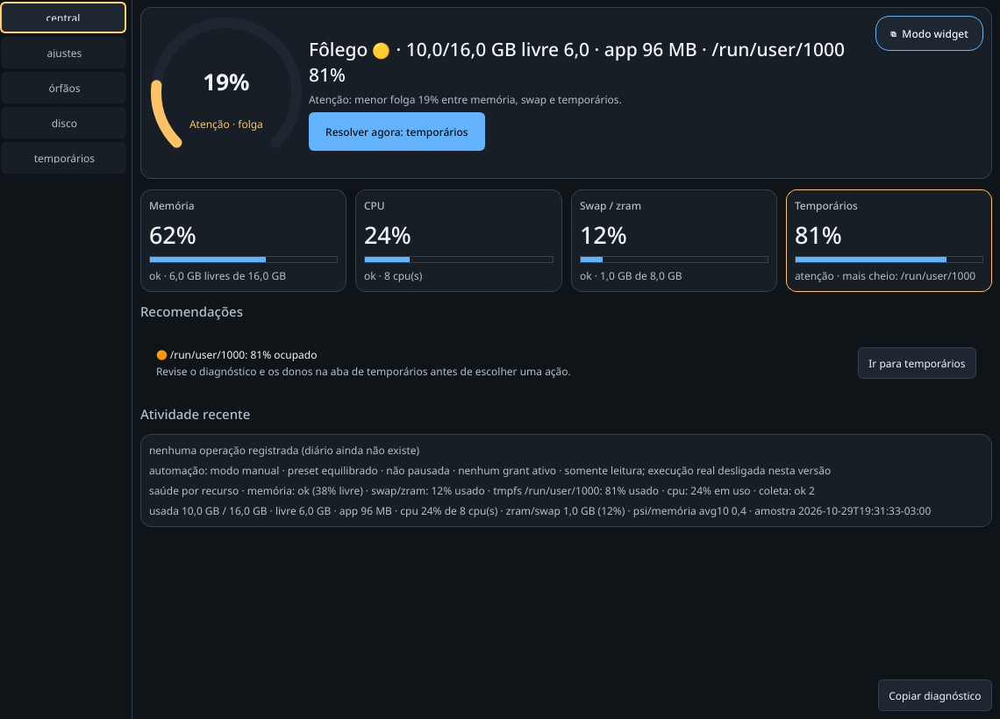
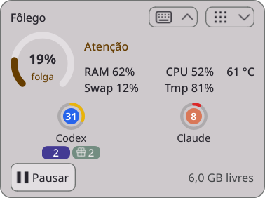

<div align="center">



**Entenda a pressão do seu Linux. Revise uma ação. Preserve seu trabalho.**

[](https://github.com/Misael-art/Folego/actions/workflows/ci.yml)
[](LICENSE)


[Começar](#começar) · [Recursos](#o-que-você-pode-fazer) · [Segurança](#seu-trabalho-vem-primeiro) · [Contribuir](CONTRIBUTING.md)

</div>

Fôlego é um assistente de recursos para Linux com interface Qt, integração com
KDE Plasma e uma CLI que funciona sem ambiente gráfico. Ele reúne memória,
CPU, swap e temporários em uma visão clara e ajuda a investigar o que está
pressionando a máquina — inclusive quando há agentes de IA, builds e várias
aplicações trabalhando ao mesmo tempo.

As ações de recursos são manuais e passam por confirmação e verificações de
proteção. **O executor automático de recursos permanece desligado.** A supervisão
de entrada tem uma política própria, opcional, para reabilitar dispositivos
identificados no KWin e restaurar perfis conhecidos de trackpad/microfone no
Steam Deck. O projeto está em desenvolvimento; os limites de validação
estão descritos abaixo.

<div align="center">



<sub>Interface real da aplicação, com dados de demonstração. Nenhum processo ou arquivo do usuário foi usado como fixture.</sub>

</div>

## O que você pode fazer

[Histórico e decisões de design](docs/DESIGN.md) reúne os mockups, revisões,
regras de adaptação e evidências de cada superfície.

| Recurso | Para que serve |
|---|---|
| **Visão geral** | Acompanhar RAM, CPU, swap/zram, tmpfs e bateria, com alertas de pressão e indicação de dados ausentes ou antigos. |
| **Diagnóstico de temporários** | Identificar os maiores consumidores, processos que mantêm arquivos abertos e caminhos oficiais de encerramento quando conhecidos. |
| **Saúde do host** | Acompanhar calor, pressão de CPU/I/O, avisos NTFS, contadores Btrfs, units de usuário instáveis e boots registrados; orientar proteção e reparo manual sem executar fsck nem desligar serviços alheios. |
| **Quarentena e recuperação** | Revisar ações de disco e tmpfs, com cópia verificada e recuperação nos fluxos suportados. |
| **Proteção de sessões** | Registrar trabalhos que devem continuar ativos e revisar candidatos sem tratar nome, idade ou CPU baixa como autorização. |
| **Ajustes reversíveis** | Revisar ajustes suportados, como opções de segundo plano do navegador, com preservação do estado anterior. |
| **Widget e bandeja** | Consultar o estado em uma janela compacta e retornar à central. No Plasma/Wayland, a regra opcional do KWin exige confirmação. |
| **CLI independente de Qt** | Investigar o ambiente e consultar operações diretamente pelo terminal. |
| **Entrada e acessibilidade** | Observar teclado, ponteiro, trackpads, toque, controles e áudio; solicitar reparo de entrada ou manter um monitor residente opcional. No Deck, distingue dispositivo presente de perfil Steam/áudio errado e restaura apenas o perfil previamente confirmado, sem depender do PhaseZero. |
| **Opções e continuidade** | Iniciar com a sessão por padrão, desativar quando quiser, consultar operações pelo código e acompanhar temporários próprios preservados. |
| **Economia da tela e agentes** | Ativar um temporizador reversível da tela interna, preservar jogos/dock e pedir alívio cooperativo aos agentes participantes. [Contrato e limites](docs/ENERGIA-E-AGENTES.md). |

Quando o sensor informa limites térmicos, a área Disco distingue aviso a 5 °C
do limite passivo, urgência ao atingi-lo e limite crítico do equipamento. Com a
bandeja disponível, o Fôlego avisa sem repetir a cada leitura. O alerta não
reduz a carga nem suspende agentes por conta própria.

O **mini horizontal** reúne estado, CPU, temperatura com fonte, RAM, bateria e
cotas de IA em células de uma linha. A largura acompanha os dados disponíveis;
entregas, resets resgatáveis e reposição confirmada de cinco horas têm lembretes
discretos. A alça pontilhada move a faixa; **Expandir** abre
o compacto, a grade abre a Central e a seta lista diretamente todos os formatos.
O **modo compacto** tem 280 px de largura e recursos em duas linhas. O ícone de
grade abre a **Central**; a seta ao lado reúne os cinco formatos,
**Contas e cotas de IA**, **Ocultar widget** e **Sair do Fôlego**. **Modo widget**, na Central, retorna ao
flutuante mantendo o monitoramento. A saída também fica na bandeja. As duas
interfaces dispensam botões de minimizar, maximizar e fechar.
O menu **Posição do widget**, na Central, e o seletor do widget permitem escolher
diretamente mini, compacto, lateral esquerda, lateral direita ou barra superior.
Passe o mouse pela borda esquerda, direita ou superior do widget para revelar a
faixa de encaixe. A seta leva, respectivamente, à barra lateral direita,
lateral esquerda ou horizontal superior. A seta na borda da barra retorna ao
compacto. As barras ocupam a área útil informada pelo desktop, respeitando
painéis conhecidos; o conteúdo lateral tem rolagem quando necessário.
A faixa de IAs mostra somente provedores com cota positiva e confirmada,
ordenados pelo percentual disponível. Contas sem cota ou sem confirmação
continuam acessíveis em **Contas e cotas de IA**; passe o mouse sobre um medidor
visível para abrir o painel da conta exibida. Consumo, resets, tickets e
referência da assinatura ficam separados. Os medidores seguem o padrão circular do PhaseZero:
disco do provedor, percentual disponível no centro e anel verde/amarelo/vermelho.
Uma cota desconhecida não é tratada como zero. O anel faz uma transição suave
ao receber um novo percentual; uma cota que volta aparece com uma transição curta
e a reposição confirmada usa o aviso sonoro existente. Entregas para revisitar
fazem a borda interna pulsar.
Quando a resposta final de um agente Codex Web relata
`McpServerError: Session terminated`, o Fôlego marca a entrega com `!` vermelho,
mostra aviso na janela e na bandeja disponível e acende a tela se a economia
de energia estiver ativa. É um relato da sessão MCP, não prova de defeito no
serviço local. Reconecte o Codex Native2 no ChatGPT e confira o resultado da
operação anterior antes de repetir. A recuperação automática do serviço local
continua com o responsável configurado no host; o Fôlego não reinicia o
cliente, o túnel ou agentes por esse texto.
Quando um turno Web falha com `Selected model is at capacity. Please try a
different model.`, o monitor solicita automaticamente um ciclo de recuperação
ao responsável já habilitado e verificado daquela conta. O pedido usa o diário
de operações e não reenvia a tarefa. O painel **Contas e cotas de IA** e
`./dev run ai status` mostram o diagnóstico recente do responsável, inclusive
quando é necessário renovar o login no ChatGPT dentro do launcher. A mensagem
de capacidade também pode encobrir uma falha local do campo de mensagem;
trocar o modelo não corrige essa situação. Sem responsável compatível, o
Fôlego avisa e preserva o estado. [Escopo e limites](docs/COMPACTO.md#recuperação-do-codex-web).
Ao lado das entregas, um **presente verde piscando** mostra as redefinições
disponíveis confirmadas das contas do provedor. Clique para consultar a conta;
o resgate continua no cliente de IA.

Os atalhos coloridos aparecem em duas linhas iguais ao passar o mouse pelo
widget e se recolhem ao sair. **Copiar, Colar e Print** ficam abaixo de
**Selecionar tudo, Apagar tudo e Prompts**. O ícone de teclado no cabeçalho abre
na parte inferior; somente sua seta abre no topo. CPU e Tmp ficam alinhados,
com a temperatura do host em °C e a rotação do cooler em RPM lado a lado na
terceira linha (sensor indisponível: **— °C** ou **— RPM**). Quando só existe a
zona térmica do sistema, a leitura mostra **ACPI** para não sugerir que mede
diretamente a CPU.
**Tmp** indica a ocupação dos temporários em memória. A altura
pode crescer para preservar alertas e mensagens. [Uso, configuração de contas,
dependências e limites](docs/COMPACTO.md).

Quando o Linux fornece uma bateria válida, o widget mostra o percentual em
verde, amarelo, laranja ou vermelho conforme a faixa. Ao descarregar, avisa
com sons nas passagens de 75%, 50% e 25%; em 10% ou menos, repete o aviso a
cada minuto. A estimativa restante aparece quando o sistema informa tempo ou
energia e consumo compatíveis. Ela varia conforme o uso. Os avisos seguem a
preferência de sons em **opções**.

A biblioteca oferece 13 prompts de desenvolvimento: escolha um título para copiar e cole no
agente desejado. O teclado virtual preserva o foco do campo de destino no KWin.
O seletor organiza os títulos em seis blocos com faixas laterais coloridas,
cabeçalhos horizontais e ícones de copiar. O painel tem até 480 × 540 px,
com rolagem e rodapé fixo para **Janelas, Edição, Terminal e Custom**.
Os três primeiros modelos seguem diagnóstico, implantação item a item e
continuação do trabalho a partir da passagem existente.
**Design e mockups para aprovação** copia o prompt integral de Product Design
fornecido pelo usuário, para propor e revisar visuais antes da implementação.
O mesmo menu inclui dez atalhos padrão em **Janelas**, **Edição** e **Terminal**:
alternar aplicativo, visão geral, posicionar à esquerda/direita, desfazer/refazer,
salvar, buscar e copiar/colar no terminal. Escolher um item envia seu atalho ao
aplicativo em foco; abrir o menu não executa as ações.
O último item, **Custom**, reúne textos e macros pessoais. Na janela principal,
aba **prompts**, use **+ Texto** ou **+ Macro** para cadastrar. Os exemplos são
o texto exato `123` (sem espaços) e **Mostrar área de trabalho**.
Na aba **opções**, escolha se o widget deve aparecer no print e teste os sons
de conclusão por agente, de 20% restantes, esgotamento e reposição confirmada.
O volume pode subir temporariamente a 85% e retornar aos valores anteriores.
Em **opções → Aparência · consoles clássicos**, escolha **SNES americano,
Super Famicom, Mega Drive / Genesis, Master System III, PC Engine, NES,
TurboGrafx-16 ou PlayStation 2**. A troca é imediata na central, no widget,
nos menus, nos painéis de contas e no teclado, inclusive os já abertos, e fica
salva para a próxima abertura. Sem preferência anterior, o padrão é SNES americano.
As paletas usam os tons de referência com ajustes de contraste para leitura;
os alertas preservam verde/âmbar/vermelho e seus textos.
No mesmo grupo, **Transparência do fundo** vai de **0% (opaco)** a **100% (sem
fundo)**. A prévia acompanha a barra e a escolha é salva ao soltá-la. Textos,
ícones, contornos de teclas e indicadores mantêm a opacidade; os painéis de
contas usam um fundo contínuo, com os elementos internos transparentes.



## Começar

O alvo é **Linux**, com KDE Plasma para a integração completa com o desktop.
O wrapper gerencia Python **3.14.7**, uv e dependências fixadas em `uv.lock`.
Não é necessário ativar um ambiente virtual ou instalar pacotes Python globalmente.
A [prévia 0.2.0b9](https://github.com/Misael-art/Folego/releases/tag/v0.2.0b9)
oferece fonte completa, wheel, sdist e SHA256SUMS. A fonte completa inclui o wrapper
e o lockfile; os pacotes Python exigem Python 3.14 e a dependência GUI opcional.

```bash
git clone --branch v0.2.0b9 https://github.com/Misael-art/Folego.git
cd Folego
./dev setup
./dev gui
```

Na primeira abertura, o Fôlego configura o **início automático com a sessão**,
ligado por padrão. A aba **opções** permite desligar e mantém sua escolha nas
próximas aberturas. O controle cobre a central e a habilitação do monitor de
entrada no login; desligar desativa a unit própria de entrada imediatamente,
sem encerrar a janela da central já aberta. Arquivos pessoais
de autostart e units sem a marca do Fôlego são preservados.

Iniciar o aplicativo não concede permissões de limpeza ou reparo. A política
de entrada e os grants de recursos continuam tendo seus próprios controles.

O primeiro setup baixa ferramentas e dependências para `.dev/`. Reserve ao menos
4 GiB livres. Se faltarem bibliotecas nativas, consulte o plano e aplique-o explicitamente:

```bash
./dev system-deps
./dev setup --system-deps
```

O segundo comando pode solicitar privilégios administrativos para instalar
bibliotecas da distribuição. Ele não habilita serviços de limpeza ou autostart.

Em servidor ou terminal sem Qt:

```bash
./dev setup --headless
./dev doctor
./dev run --help
```

O [guia de ambiente](docs/NOVO-HOST.md) detalha requisitos, isolamento e recuperação.
O [guia de empacotamento](packaging/README.md) cobre os fluxos de instalação do pacote.

## Explore pelo terminal

Estas consultas não limpam arquivos nem encerram processos:

```bash
./dev doctor
./dev run tmpfs status
./dev run tmpfs diagnose --json
./dev run session list --json
./dev run automation status --json
./dev run accessibility status --json
./dev run startup status --json
./dev run disk health --json
./dev run disk guide ntfs
./dev run disk recovery /dev/mmcblk0p1 --json
./dev run disk timeline --json
```

**Saúde do host** aparece na Central e no início da aba Disco. A temperatura e
a pressão vêm da coleta de recursos; integridade, units e boots são consultados
separadamente a cada cinco minutos enquanto o Fôlego monitora. A CLI consulta
sob demanda, sem alterar o host. A GUI guarda um pequeno ponto de comparação
dos contadores Btrfs em seu estado XDG; o primeiro valor é histórico de idade
desconhecida, e uma falha nesse estado não é tratada como contador zerado.
Avisos NTFS são buscados em janela limitada do journal, incluindo o número de
índices identificados, sem percorrer o volume. Enquanto a GUI monitora, uma
amostra privada e limitada de RAM, swap, PSI, temperatura e maior CPU é gravada
a cada 15 segundos para investigar o período anterior a um reinício, incluindo
estado da bateria do Deck e presença observada de alimentação externa; a CLI
`disk timeline` lê até 80 amostras recentes, ou de um boot preservado com
`--boot-id`. O histórico possui limites de
4 MiB por boot e 32 MiB no total; ao atingir o limite, a gravação para e o
registro existente é preservado. A falha de gravação aparece na Central, e
capacidade a partir de 85% do limite aparece na aba Disco e na CLI. A leitura
principal da GUI ocorre a cada 5 segundos; o alerta de pressão usa o PSI já
coletado, exige leituras sustentadas e limita avisos na bandeja a um por tipo
de pressão a cada 5 minutos. O histórico registra também as médias PSI de
60 segundos, em porcentagem, para explicar avisos após um reinício. O alerta
recomenda reduzir tarefas pelo aplicativo responsável e não altera processos.
O plano para
continuidade e dossiês está no [roadmap de resiliência](docs/ROADMAP-RESILIENCIA-HOST.md).
`disk recovery` só verifica identidade da
origem, montagem, acesso bruto, ferramenta e destino independente com espaço
para imagem integral e margem. A checagem não abre o dispositivo nem concede
autorização futura: todos os pontos devem ser revalidados antes de qualquer
cópia ou reparo.
Sem permissão, sensor ou histórico, a interface mostra **desconhecido**. As
orientações não executam `ntfsfix`, `btrfs scrub`, `btrfs check --repair`,
parada de serviços ou reinício do host. Consulte também [os limites e o
mockup](docs/handoff/validation/host-guard-2026-11-05/README.md).

Para NTFS danificado, a [documentação do NTFS-3G](https://github.com/tuxera/ntfs-3g/blob/edge/ntfsprogs/ntfsfix.8.in)
limita `ntfsfix` a algumas inconsistências fundamentais. A cópia de resgate
retomável pode usar [GNU ddrescue](https://www.gnu.org/software/ddrescue/manual/ddrescue_manual.html)
quando houver destino independente suficiente e o volume puder ser desmontado
sem interromper consumidores desconhecidos. A pré-checagem do Fôlego não cria
essa cópia; a fonte original não é reparada automaticamente.

Para acompanhar um comando seu como sessão protegida:

```bash
./dev run session run --project meu-projeto --manter-ativo -- comando argumento
```

Alterações exigem uma escolha explícita. O redimensionamento do runtime apresenta
opções antes de executar e usa autenticação do sistema. Ele altera uma configuração
**global do logind** e remonta somente o runtime do usuário atual. Não o use para
substituir o diagnóstico de um produtor descontrolado.

Uma operação sem resposta permanece desconhecida. Consulte o mesmo ID:

```bash
./dev run operation ID --json
./dev run tmpfs runtime-size --reconciliar ID --json
```

A reconciliação verifica evidência de término e o estado atual; não repete o
redimensionamento. Se a evidência ainda faltar, a operação continua bloqueada.
Em uma falha parcial, o resultado informa separadamente o tamanho montado e a
configuração persistente. A configuração anterior, quando existia, é preservada
no caminho `previous_config` devolvido pela operação para recuperação explícita.

## Supervisão de entrada

A aba **acessibilidade** tem **cards que são botões**: clique em teclado,
trackpads, toque, controles, teclado virtual, saída de áudio ou microfone para
habilitar e verificar aquela capacidade. **Habilitar tudo** tenta cada uma e
apresenta resultados separados. Verde indica configuração verificada no sistema;
amarelo indica falha, conflito ou ausência de confirmação. O teste físico continua
necessário. **Verificar agora** mostra horário e resumo; **Registrar configuração
para preservar** salva as entradas habilitadas e solicita a persistência das
preferências ao responsável compatível. O resumo também aparece na central. As fontes
são locais: kernel, compositor e, quando disponíveis, serviços de áudio e
responsáveis externos. PhaseZero e RetroFE são integrações opcionais.

Em **KDE/Wayland**, o reparo suportado reabilita uma entrada identificada no
KWin. A política automática preserva somente dispositivos antes observados
habilitados; estado incompleto, outro responsável ou uma operação sem resultado
bloqueiam a atuação. Em outros desktops, a observação disponível continua,
com indicação explícita da ausência de backend de reparo.

Para ativar a política e o monitor da sessão do usuário:

```bash
./dev run accessibility enable --confirmar
./dev run accessibility install --confirmar
```

O monitor funciona após fechar a janela e acompanha o login gráfico. Antes de
desabilitar uma entrada intencionalmente, pause os reparos:

```bash
./dev run accessibility disable --confirmar
```

Para controlar o início com a sessão pelo terminal:

```bash
./dev run startup enable --confirmar
./dev run startup disable --confirmar
```

Enumeração não comprova movimento, clique, digitação, toque ou áudio físico.
Reparos de driver, atalhos Steam, perfis de jogo e entrada antes do login não
fazem parte do executor **automático**. Na ação manual, um reparador FTS dedicado
e registrado pode recuperar a tela de toque em hardware compatível, com
autenticação do sistema quando necessária. Nenhuma ação fecha o Steam ou
reinicia o desktop. O [guia de acessibilidade](docs/ACESSIBILIDADE.md)
explica limites, recuperação, desinstalação e coordenação com outras aplicações.

## Uma revisão, uma operação

As ações de ajustes, liberação de tmpfs, restauração e expiração preparam uma
revisão durável antes da confirmação. A GUI compara os alvos e tamanhos com a
lista apresentada, exibe o código e a validade e executa o mesmo plano.
Mudanças posteriores em conteúdo, backup ou vítimas recusam o efeito.

Na aba **opções**, consulte pelo código, verifique operações pendentes ou cancele
uma revisão que ainda não iniciou. A confirmação de um resultado libera somente
o bloqueio da operação correspondente. Resultado desconhecido não autoriza retry.
Um exemplo pela CLI, sem executar na primeira etapa:

```bash
./dev run review plan --command '["tune","apply","edge.startup_boost"]' --json
./dev run review pending --json
./dev run review reconcile ID --json
./dev run review cancel ID --confirmar --json
```

Para executar, passe o objeto `review` completo a `review execute --plan JSON
--confirmar --json`. Expiração e purga também exigem `--irreversivel`. Os comandos
diretos dos domínios continuam disponíveis e usam o mesmo coordenador.

## Temporários do próprio Fôlego

Os workers de consulta/mutação registram raiz/diretório, boot, PID/starttime e sessão.
Somente execuções encerradas com ausência de consumidores/referências comprovada podem
sair dos slots ativos para `.retained`, no mesmo filesystem persistente.
**O conteúdo é preservado; não há exclusão automática de payloads.**

O limite de 256 slots ativos permanece. A retenção tem orçamento de 1 GiB e
inventário limitado; esgotamento, montagens, conteúdo protegido, arquivos em uso
ou observação incompleta exigem revisão. Diretórios antigos sem prova de ciclo
de vida permanecem protegidos. `.scratch/dev-tests` tem sua própria política e
não participa dessa manutenção do produto.

```bash
./dev run jobs status --json
./dev run jobs retain --confirmar --json
```

`--root CAMINHO` seleciona uma raiz própria explicitamente. A aba **opções**
mostra a raiz dos jobs da GUI e permite solicitar a retenção sem apagar dados.

## Seu trabalho vem primeiro

- **Intenção antes do efeito.** Mutações coordenadas registram o que será feito e o resultado observado.
- **Desconhecido continua desconhecido.** Timeout, leitura incompleta ou falta de evidência não autorizam uma repetição cega.
- **Processos têm identidade.** Proteções consideram boot, PID/starttime, sessões, exclusões e ancestrais; SIGKILL é uma ação manual separada.
- **Dados importantes são protegidos.** Projetos, Git, credenciais, bancos, modelos, volumes e discos virtuais têm restrições próprias.
- **Recuperação é parte do fluxo.** Cópias de tmpfs exigem destino persistente, espaço, staging e verificação.
- **Presets não concedem permissão.** Modos Manual, Assistido e Automático são distintos; o executor automático de recursos está desligado. A política de entrada é separada e precisa de ativação explícita.

## Estado do projeto

Há testes de núcleo, CLI, persistência, falhas, processos próprios e Qt offscreen,
além de evidências de desktop documentadas. Isso não equivale a certificar todos
os ambientes ou considerar o produto concluído.

Um ensaio contínuo de **duas horas reais** foi aprovado no perfil controlado:
GUI Wayland com coletor sintético, workers e cancelamentos próprios, arquivo
restaurado e diário verificado. [Resultados e limites](docs/handoff/validation/session-resilience-2026-10-30/soak/README.md).

O inventário e a recuperação dos temporários administrados e o fluxo “Dar fôlego”
estão integrados à GUI e à CLI. A retenção real neste host ainda depende de
comprovar a ausência de consumidores que hoje não podem ser inspecionados. A
matriz física de acessibilidade e desktop e um soak da fonte atual permanecem
pendentes. O ensaio controlado acima vale somente para a fonte congelada nele.

O estado técnico vigente, os comandos verificados e as próximas tarefas ficam em
[HANDOFF](docs/HANDOFF.md). O [diagnóstico consolidado](docs/DIAGNOSTICO-2026-10-24.md)
preserva o alcance e as limitações das evidências históricas.

## Desenvolvimento

```bash
./dev test-headless   # núcleo e CLI, sem Qt
./dev test            # suíte completa com Qt offscreen
./dev check           # ambas, sequencialmente, e revisão de whitespace
```

Os testes usam HOME/XDG privados e temporários exclusivos em disco. As suítes
completas devem rodar sequencialmente. Logs ficam em `.scratch/dev-tests/`, com
orçamentos de revisão e sem limpeza automática.

```text
src/folego/
├── core/            # coleta, saúde e proteção; sem Qt
├── actions/         # operações por domínio e integração com o coordenador
├── orchestration/   # planos, diário, autorização e resultados
├── safely/          # persistência, verificação e recuperação
└── ui/              # central, widget, bandeja e apresentação do estado
tests/               # contratos e regressões em árvores descartáveis
tools/               # bootstrap e verificadores de desenvolvimento
packaging/           # instalação e launcher
```

Leia [CONTRIBUTING](CONTRIBUTING.md) para preparar uma contribuição e
[AGENTS.md](AGENTS.md) para as regras de trabalho automatizado.
Problemas reproduzíveis e propostas bem delimitadas são bem-vindos em
[Issues](https://github.com/Misael-art/Folego/issues).

## Licença

O código do Fôlego é disponibilizado sob a [licença MIT](LICENSE).
Dependências mantêm suas próprias licenças; veja [THIRD_PARTY_NOTICES](THIRD_PARTY_NOTICES.md),
incluindo os avisos de Qt/PySide6.
