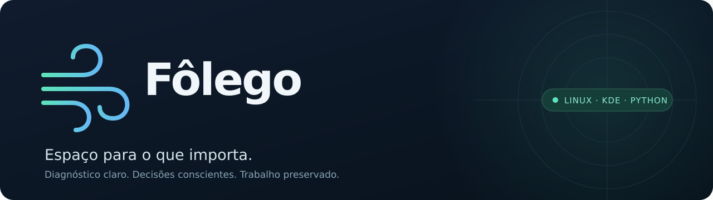
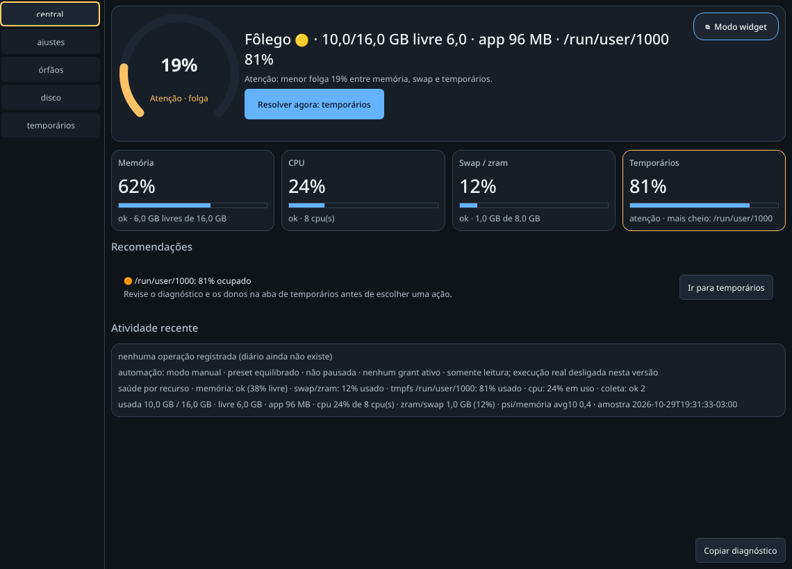

<div align="center">



**Entenda a pressão do seu Linux. Revise uma ação. Preserve seu trabalho.**

[](https://github.com/Misael-art/Folego/actions/workflows/ci.yml)
[](LICENSE)


[Começar](#começar) · [Recursos](#o-que-você-pode-fazer) · [Segurança](#seu-trabalho-vem-primeiro) · [Contribuir](CONTRIBUTING.md)

</div>

Fôlego é um assistente de recursos para Linux com interface Qt, integração com
KDE Plasma e uma CLI que funciona sem ambiente gráfico. Ele reúne memória,
CPU, swap e temporários em uma visão clara e ajuda a investigar o que está
pressionando a máquina — inclusive quando há agentes de IA, builds e várias
aplicações trabalhando ao mesmo tempo.

As ações de recursos são manuais e passam por confirmação e verificações de
proteção. **O executor automático de recursos permanece desligado.** A supervisão
de entrada tem uma política própria, opcional, para reabilitar dispositivos
identificados no KWin. O projeto está em desenvolvimento; os limites de validação
estão descritos abaixo.

<div align="center">



<sub>Interface real da aplicação, com dados de demonstração. Nenhum processo ou arquivo do usuário foi usado como fixture.</sub>

</div>

## O que você pode fazer

| Recurso | Para que serve |
|---|---|
| **Visão geral** | Acompanhar RAM, CPU, swap/zram e tmpfs, com alertas de pressão e indicação de dados ausentes ou antigos. |
| **Diagnóstico de temporários** | Identificar os maiores consumidores, processos que mantêm arquivos abertos e caminhos oficiais de encerramento quando conhecidos. |
| **Quarentena e recuperação** | Revisar ações de disco e tmpfs, com cópia verificada e recuperação nos fluxos suportados. |
| **Proteção de sessões** | Registrar trabalhos que devem continuar ativos e revisar candidatos sem tratar nome, idade ou CPU baixa como autorização. |
| **Ajustes reversíveis** | Revisar ajustes suportados, como opções de segundo plano do navegador, com preservação do estado anterior. |
| **Widget e bandeja** | Consultar o estado em uma janela compacta e retornar à central. No Plasma/Wayland, a regra opcional do KWin exige confirmação. |
| **CLI independente de Qt** | Investigar o ambiente e consultar operações diretamente pelo terminal. |
| **Entrada e acessibilidade** | Observar teclado, ponteiro, trackpads, toque, controles e áudio; solicitar reparo de entrada ou manter um monitor residente opcional, sem depender do PhaseZero. |
| **Opções e continuidade** | Iniciar com a sessão por padrão, desativar quando quiser, consultar operações pelo código e acompanhar temporários próprios preservados. |

## Começar

O alvo é **Linux**, com KDE Plasma para a integração completa com o desktop.
O wrapper gerencia Python **3.14.7**, uv e dependências fixadas em `uv.lock`.
Não é necessário ativar um ambiente virtual ou instalar pacotes Python globalmente.

```bash
git clone https://github.com/Misael-art/Folego.git
cd Folego
./dev setup
./dev gui
```

Na primeira abertura, o Fôlego configura o **início automático com a sessão**,
ligado por padrão. A aba **opções** permite desligar e mantém sua escolha nas
próximas aberturas. O controle cobre a central e a habilitação do monitor de
entrada no login; desligar não encerra um monitor já aberto. Arquivos pessoais
de autostart e units sem a marca do Fôlego são preservados.

Iniciar o aplicativo não concede permissões de limpeza ou reparo. A política
de entrada e os grants de recursos continuam tendo seus próprios controles.

O primeiro setup baixa ferramentas e dependências para `.dev/`. Reserve ao menos
4 GiB livres. Se faltarem bibliotecas nativas, consulte o plano e aplique-o explicitamente:

```bash
./dev system-deps
./dev setup --system-deps
```

O segundo comando pode solicitar privilégios administrativos para instalar
bibliotecas da distribuição. Ele não habilita serviços de limpeza ou autostart.

Em servidor ou terminal sem Qt:

```bash
./dev setup --headless
./dev doctor
./dev run --help
```

O [guia de ambiente](docs/NOVO-HOST.md) detalha requisitos, isolamento e recuperação.
O [guia de empacotamento](packaging/README.md) cobre os fluxos de instalação do pacote.

## Explore pelo terminal

Estas consultas não limpam arquivos nem encerram processos:

```bash
./dev doctor
./dev run tmpfs status
./dev run tmpfs diagnose --json
./dev run session list --json
./dev run automation status --json
./dev run accessibility status --json
./dev run startup status --json
```

Para acompanhar um comando seu como sessão protegida:

```bash
./dev run session run --project meu-projeto --manter-ativo -- comando argumento
```

Alterações exigem uma escolha explícita. O redimensionamento do runtime apresenta
opções antes de executar e usa autenticação do sistema. Ele altera uma configuração
**global do logind** e remonta somente o runtime do usuário atual. Não o use para
substituir o diagnóstico de um produtor descontrolado.

Uma operação sem resposta permanece desconhecida. Consulte o mesmo ID:

```bash
./dev run operation ID --json
./dev run tmpfs runtime-size --reconciliar ID --json
```

A reconciliação verifica evidência de término e o estado atual; não repete o
redimensionamento. Se a evidência ainda faltar, a operação continua bloqueada.
Em uma falha parcial, o resultado informa separadamente o tamanho montado e a
configuração persistente. A configuração anterior, quando existia, é preservada
no caminho `previous_config` devolvido pela operação para recuperação explícita.

## Supervisão de entrada

A aba **acessibilidade** tem **cards que são botões**: clique em teclado,
trackpads, toque, controles, teclado virtual, saída de áudio ou microfone para
habilitar e verificar aquela capacidade. **Habilitar tudo** tenta cada uma e
apresenta resultados separados. Verde indica configuração verificada no sistema;
amarelo indica falha, conflito ou ausência de confirmação. O teste físico continua
necessário. **Verificar agora** mostra horário e resumo; **Registrar configuração
para preservar** salva as entradas habilitadas e solicita a persistência das
preferências ao responsável compatível. O resumo também aparece na central. As fontes
são locais: kernel, compositor e, quando disponíveis, serviços de áudio e
responsáveis externos. PhaseZero e RetroFE são integrações opcionais.

Em **KDE/Wayland**, o reparo suportado reabilita uma entrada identificada no
KWin. A política automática preserva somente dispositivos antes observados
habilitados; estado incompleto, outro responsável ou uma operação sem resultado
bloqueiam a atuação. Em outros desktops, a observação disponível continua,
com indicação explícita da ausência de backend de reparo.

Para ativar a política e o monitor da sessão do usuário:

```bash
./dev run accessibility enable --confirmar
./dev run accessibility install --confirmar
```

O monitor funciona após fechar a janela e acompanha o login gráfico. Antes de
desabilitar uma entrada intencionalmente, pause os reparos:

```bash
./dev run accessibility disable --confirmar
```

Para controlar o início com a sessão pelo terminal:

```bash
./dev run startup enable --confirmar
./dev run startup disable --confirmar
```

Enumeração não comprova movimento, clique, digitação, toque ou áudio físico.
Reparos de driver, atalhos Steam, perfis de jogo e entrada antes do login não
fazem parte do executor **automático**. Na ação manual, um reparador FTS dedicado
e registrado pode recuperar a tela de toque em hardware compatível, com
autenticação do sistema quando necessária. Nenhuma ação fecha o Steam ou
reinicia o desktop. O [guia de acessibilidade](docs/ACESSIBILIDADE.md)
explica limites, recuperação, desinstalação e coordenação com outras aplicações.

## Uma revisão, uma operação

As ações de ajustes, liberação de tmpfs, restauração e expiração preparam uma
revisão durável antes da confirmação. A GUI compara os alvos e tamanhos com a
lista apresentada, exibe o código e a validade e executa o mesmo plano.
Mudanças posteriores em conteúdo, backup ou vítimas recusam o efeito.

Na aba **opções**, consulte pelo código, verifique operações pendentes ou cancele
uma revisão que ainda não iniciou. A confirmação de um resultado libera somente
o bloqueio da operação correspondente. Resultado desconhecido não autoriza retry.
Um exemplo pela CLI, sem executar na primeira etapa:

```bash
./dev run review plan --command '["tune","apply","edge.startup_boost"]' --json
./dev run review pending --json
./dev run review reconcile ID --json
./dev run review cancel ID --confirmar --json
```

Para executar, passe o objeto `review` completo a `review execute --plan JSON
--confirmar --json`. Expiração e purga também exigem `--irreversivel`. Os comandos
diretos dos domínios continuam disponíveis e usam o mesmo coordenador.

## Temporários do próprio Fôlego

Os workers de consulta/mutação registram raiz/diretório, boot, PID/starttime e sessão.
Somente execuções encerradas com ausência de consumidores/referências comprovada podem
sair dos slots ativos para `.retained`, no mesmo filesystem persistente.
**O conteúdo é preservado; não há exclusão automática de payloads.**

O limite de 256 slots ativos permanece. A retenção tem orçamento de 1 GiB e
inventário limitado; esgotamento, montagens, conteúdo protegido, arquivos em uso
ou observação incompleta exigem revisão. Diretórios antigos sem prova de ciclo
de vida permanecem protegidos. `.scratch/dev-tests` tem sua própria política e
não participa dessa manutenção do produto.

```bash
./dev run jobs status --json
./dev run jobs retain --confirmar --json
```

`--root CAMINHO` seleciona uma raiz própria explicitamente. A aba **opções**
mostra a raiz dos jobs da GUI e permite solicitar a retenção sem apagar dados.

## Seu trabalho vem primeiro

- **Intenção antes do efeito.** Mutações coordenadas registram o que será feito e o resultado observado.
- **Desconhecido continua desconhecido.** Timeout, leitura incompleta ou falta de evidência não autorizam uma repetição cega.
- **Processos têm identidade.** Proteções consideram boot, PID/starttime, sessões, exclusões e ancestrais; SIGKILL é uma ação manual separada.
- **Dados importantes são protegidos.** Projetos, Git, credenciais, bancos, modelos, volumes e discos virtuais têm restrições próprias.
- **Recuperação é parte do fluxo.** Cópias de tmpfs exigem destino persistente, espaço, staging e verificação.
- **Presets não concedem permissão.** Modos Manual, Assistido e Automático são distintos; o executor automático de recursos está desligado. A política de entrada é separada e precisa de ativação explícita.

## Estado do projeto

Há testes de núcleo, CLI, persistência, falhas, processos próprios e Qt offscreen,
além de evidências de desktop documentadas. Isso não equivale a certificar todos
os ambientes ou considerar o produto concluído.

Um ensaio contínuo de **duas horas reais** foi aprovado no perfil controlado:
GUI Wayland com coletor sintético, workers e cancelamentos próprios, arquivo
restaurado e diário verificado. [Resultados e limites](docs/handoff/validation/session-resilience-2026-10-30/soak/README.md).

Continuam pendentes a política integral de retenção dos temporários administrados,
a conclusão do fluxo “Dar fôlego” e partes da matriz física de acessibilidade e
desktop. O ensaio controlado não certifica essas condições.

O estado técnico vigente, os comandos verificados e as próximas tarefas ficam em
[HANDOFF](docs/HANDOFF.md). O [diagnóstico consolidado](docs/DIAGNOSTICO-2026-10-24.md)
preserva o alcance e as limitações das evidências históricas.

## Desenvolvimento

```bash
./dev test-headless   # núcleo e CLI, sem Qt
./dev test            # suíte completa com Qt offscreen
./dev check           # ambas, sequencialmente, e revisão de whitespace
```

Os testes usam HOME/XDG privados e temporários exclusivos em disco. As suítes
completas devem rodar sequencialmente. Logs ficam em `.scratch/dev-tests/`, com
orçamentos de revisão e sem limpeza automática.

```text
src/folego/
├── core/            # coleta, saúde e proteção; sem Qt
├── actions/         # operações por domínio e integração com o coordenador
├── orchestration/   # planos, diário, autorização e resultados
├── safely/          # persistência, verificação e recuperação
└── ui/              # central, widget, bandeja e apresentação do estado
tests/               # contratos e regressões em árvores descartáveis
tools/               # bootstrap e verificadores de desenvolvimento
packaging/           # instalação e launcher
```

Leia [CONTRIBUTING](CONTRIBUTING.md) para preparar uma contribuição e
[AGENTS.md](AGENTS.md) para as regras de trabalho automatizado.
Problemas reproduzíveis e propostas bem delimitadas são bem-vindos em
[Issues](https://github.com/Misael-art/Folego/issues).

## Licença

O código do Fôlego é disponibilizado sob a [licença MIT](LICENSE).
Dependências mantêm suas próprias licenças; veja [THIRD_PARTY_NOTICES](THIRD_PARTY_NOTICES.md),
incluindo os avisos de Qt/PySide6.
