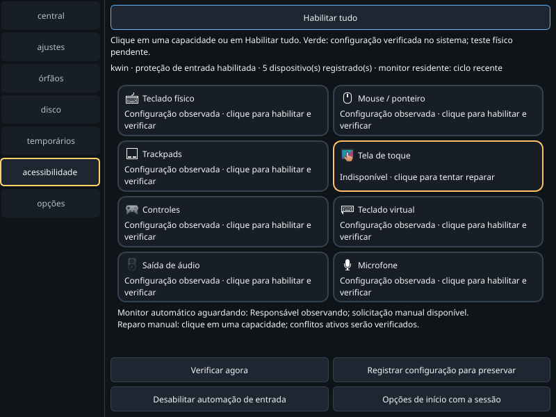
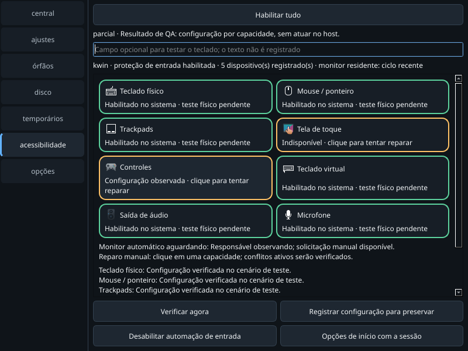
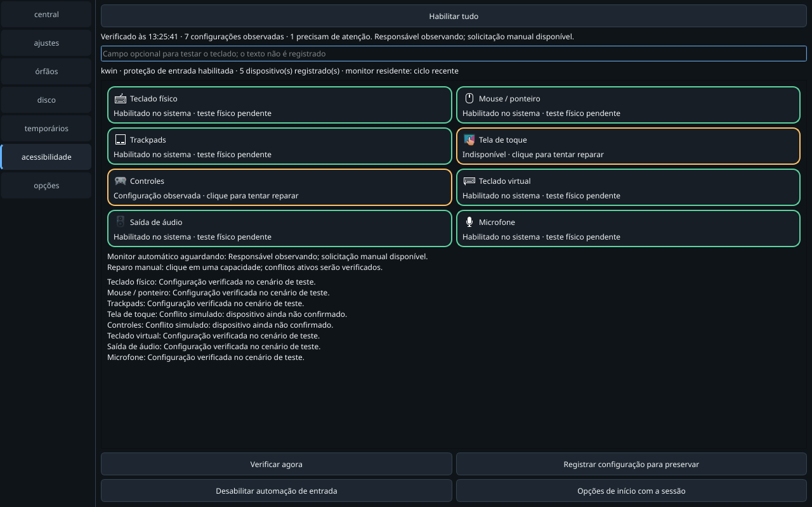

# Incidente de acessibilidade — 30/10/2026

Entrega parcial de recuperação: interface e fluxo manual corrigidos; tela de
toque deste host continua sem nó de entrada após timeout I²C. Não declarar
disponibilidade física universal nem aceite de login sem teclado externo.

## Diagnóstico observado

- Consultados os quatro boots disponíveis, com coleta limitada dos registros
  relevantes de kernel, SDDM e serviços de entrada, além dos logs Steam/RetroFE.
  Os brutos ficam privados em `run-accessibility-incident-20261030`, fora do Git.
- FTS3528 existe como cliente ACPI/I²C, mas sem driver/filho de entrada. Kernel
  registrou `controller timed out` em AMDI0010:01 em três boots. Reparo manual
  pelo helper dedicado reanexou somente esse adapter; o timeout repetiu e o nó
  FTS não reapareceu. Não houve reset USB/Valve HID ou reboot como teste.
- O monitor Fôlego aguardava o serviço PhaseZero ativo, baseline vazio e nenhum
  plano nativo: o botão de reparo ficava desabilitado. A ação manual agora pede
  ao owner registrado uma rotina restrita, sem chamar a restauração de áudio.
- SDDM efetivo usa Wayland/KWin com Maliit; é uma sessão diferente do desktop.
  O erro do greeter às 09:06:03 coincide com **Reboot solicitado**, portanto não
  demonstra a causa da perda de entrada anterior. Login físico não reproduzido.
- RetroFE registrou recusa da preparação CEF por Steam ainda aberto. A ação de
  controles do Fôlego usa URI pública, sem fechar Steam; perfil não confirmado
  permanece amarelo. Não se alterou o launcher RetroFE neste lote.

## Fluxo visual revisado

As imagens abaixo são da aplicação Qt real em KDE/Wayland, com **dados e efeitos
simulados** em HOME privado. Não são prova de reparo físico. A captura inicial
fornecida pelo operador mostrou cards sem ação, botão desabilitado e ações dentro
da rolagem; seu arquivo original não foi republicado.

1. **Escolher capacidade — corrigido.** O card inteiro é um botão com nome
   acessível, clique, Tab e Espaço. Ausente/conflito fica amarelo. A ação principal
   e controles ficam fora da rolagem; 800×600 conserva os botões visíveis.

   

2. **Habilitar e ler resultado — corrigido, aceite físico pendente.** Verde
   exige resultado vinculado ao ID e verificação no sistema; clique não basta.
   Cada capacidade recebe motivo próprio. O foco não substitui a cor de estado.

   

3. **Verificar e registrar — corrigido.** A verificação mostra progresso, horário
   e contagem. O registro preserva somente entradas identificadas habilitadas e
   preferências no owner compatível. Não promove hardware ausente a saudável.

   

Uma repetição do harness leu geometria antes da configuração final do compositor
e encontrou 800×565. A prova aceita espera a janela estabilizar, registra dimensões
solicitadas e efetivas e confere controles dentro da altura efetiva, sem alterar
os limites do produto. Prova aceita: 800×600 e 1280×800, `native-ui.json`.

## Falha sem dock e correção de autenticação

O operador informou uma nova tentativa sem dock: o pedido de senha não ofereceu
teclado utilizável. O ID terminou incerto após timeout e bloqueava inclusive o
teclado. Corrigido: campo de texto antes da autenticação; APIs do owner
`recover-touch`/`persist-touch` confirmam painel visível antes de root, mantêm
modo 2 temporário durante a troca de foco e restauram o modo anterior. A trava
comum faz o watcher ceder, preservando abertura automática por toque após o fim.
Ausência de teclado recusa a autenticação; senha nunca entra no processo Fôlego.

O card de teclado virtual permite abertura explícita mesmo com esse reparo
incerto, sem apagar o ID ou repetir hardware. Essa saída foi exercitada na
sessão real: KWin confirmou painel visível e retorno ao modo 1; a operação
anterior permaneceu pendente. Não se pediu outra senha para testar o novo fluxo.
A digitação física no polkit sem dock permanece **pendente de aceite**.

## Validação e operação no host

- `./dev check`, Python 3.14.7: **1037 passed, 2 skipped em 29,94 s** sem Qt;
  **1291 passed, 2 skipped em 50,21 s** Qt 6.12.0 offscreen. Dois skips por
  perfil exigem Edge real. Logs em `headless.log` e `gui.log`.
- A tentativa anterior falhou por deadline Hypothesis em teste preexistente de
  backup: 376,67 ms na primeira chamada, 20,10 ms na repetição interna, limite
  200 ms. Evidência privada `run-u3ylohaq` preservada; nenhum limite foi elevado.
  A suíte completa seguinte passou, com os mesmos limites e execução sequencial.
- PhaseZero: **22 passed em 6,37 s** no foco `test_desktop_session.py`, incluindo
  foco/cancelamento/timeout/sem teclado. Runtime gerenciado compatível do Fôlego,
  HOME/XDG privados; doctor core PhaseZero indisponível, sem instalação global.
- GUI oficial atualizada por sua ação de saída e reabertura, sem sinal a processos
  de terceiros. Reiniciados somente monitor Fôlego e owner PhaseZero para carregar
  a coordenação validada. Steam e guardião RetroFE preservados.
- Cinco identidades de entradas antes habilitadas registradas; FTS ausente foi
  excluído do estado saudável. Início automático conferido **ligado** e monitor
  ativo. A supervisão automática ainda aguarda o owner, sem contornar seus guards.

O soak histórico de duas horas precede esta implementação e não a certifica.
Continuam abertos: recuperação do FTS no kernel/hardware, login SDDM físico,
autenticação sem dock, digitação/movimento/áudio reais, transições de sessão e
soak desta revisão. Sem merge/release. Ver [guia operacional](../../../ACESSIBILIDADE.md).

Referências técnicas consultadas: [KWin InputMethod](https://github.com/KDE/kwin/blob/master/src/inputmethod.cpp),
[SDDM configuração](https://github.com/sddm/sddm/blob/develop/data/man/sddm.conf.rst.in),
[Linux I²C sysfs](https://docs.kernel.org/i2c/i2c-sysfs.html).
