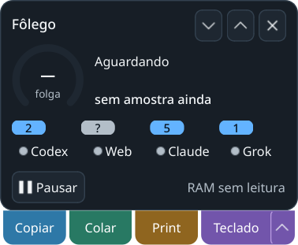
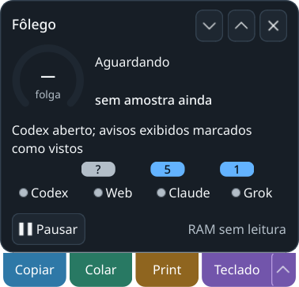

# Avisos de entregas de IAs — 01/11/2026

Incremento sobre `c9d1af66b0466ed751f718cbbde231d444b67d33`, na branch de
continuidade. Os hashes em [source-hashes.json](source-hashes.json) identificam
exatamente o código, testes e roteiro deste registro; o manifesto da release
anterior não foi alterado.

## Contratos e testes

`./dev check`, Python 3.14.7, ambientes gerenciados distintos, HOME/XDG/TMP
privados e suítes sequenciais:

- [Headless](headless-pytest.log): **1079 passed, 2 skipped**, 20,57 s.
- [Qt offscreen](gui-pytest.log): **1339 passed, 2 skipped**, 37,21 s.
- Os dois skips continuam dependendo do Edge real; não foram desativados gates.

Regressões cobrem identidade de sessões principais, Codex/Claude/Grok,
deduplicação, retomada, recibos duráveis, conclusão posterior ao clique,
inventário acima do orçamento, cauda incompleta, estado desconhecido,
contagem mínima parcial, foco confirmado e recusa diante de troca de PID.
Os registros de execução guardam os ambientes/contagens; workspaces anteriores
próprios, concluídos e revisados foram preservados integralmente em
`.scratch/dev-tests-reviewed`, sem apagar fixtures nem aumentar limites.

## KDE/Wayland real e reabertura

Comando: `.dev/venv-gui/bin/python tools/verify_agent_deliveries.py --state
.scratch/delivery-native-20261101-final`. [Recibo](native-result.json).

Sessões sintéticas em HOME privado produzem Codex **2**, Claude **5** e Grok
**1**. O clique do widget percorre o controller assíncrono, ativa uma janela
própria, confirma foco/identidade e marca somente os dois avisos do Codex como
vistos. Claude/Grok permanecem e o recibo sobrevive a um novo monitor. A busca
por aplicação é substituída nessa prova pela janela própria exata; não certifica
o foco em todas as aplicações reais nem seleciona uma conversa interna.
A busca de produção, somente leitura, também identificou janelas locais dos
quatro provedores neste host, sem ativá-las ou enviar comandos.

Capturas são `QWidget.grab()` na sessão Wayland real, com recursos ainda sem
amostra (280 × 268 px). A largura permanece 280 px; a faixa de avisos acrescenta
14 px. Feedback e alertas podem aumentar a altura. As capturas não são screenshots
do compositor e não comprovam arraste físico ou soak.

Primeira tentativa preservada em `.scratch/delivery-native-20261101`: o ambiente
herdava `CODEX_HOME` do agente, invalidando o isolamento. O roteiro passou a
remover somente as três variáveis de caminho dos provedores no próprio ambiente
de QA. Segunda execução e execução final passaram; nenhum log nativo de agente
foi usado como fixture ou alterado.

Após os gates, a instância real antiga do Fôlego não encerrou pela ação AT-SPI
no controle oculto. PID, starttime e argv foram conferidos, SIGTERM enviado uma
única vez por pidfd, e liberação do flock observada. `./dev gui` foi aberto uma
vez, no HOME real, e o botão de modo widget acionado. AT-SPI confirmou o widget
visível e os quatro indicadores com o novo texto acessível de entregas. O Fôlego
foi deixado aberto para validação do usuário. Nenhum agente/terminal foi encerrado.

O produto mantém estado e recibos próprios. A release v0.2.0b1 continua sendo o
artefato anterior; este incremento está no código/PR para validação local.
Continuam os limites gerais do produto registrados no [handoff](../../../HANDOFF.md).
