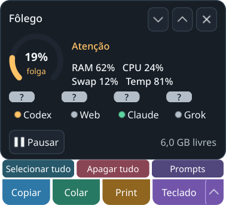
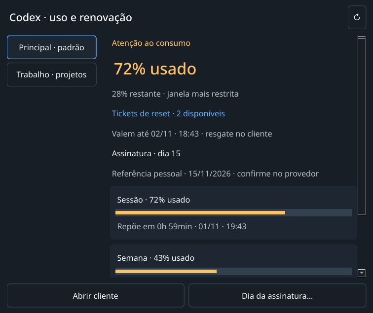
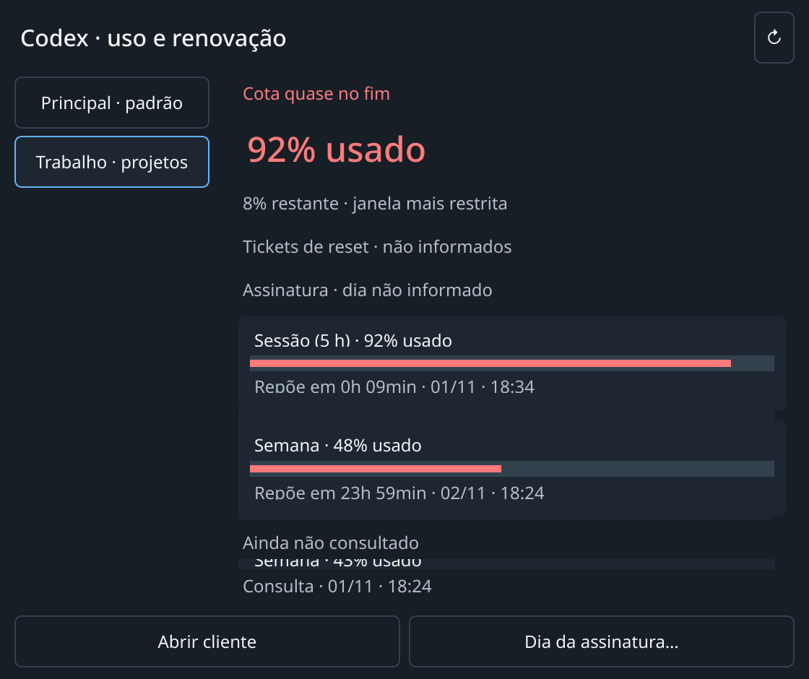
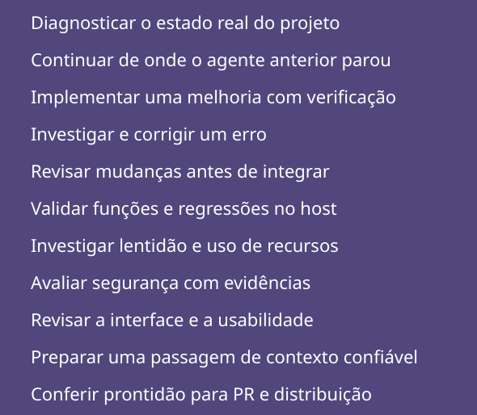

# Contas de IA, teclado e prompts — 01/11/2026

Código `3aae6c9692b2b5b312561e7a90cd8b4e01778f5b`, sobre `b5e400330495d1ca42985f519b4c5044ab07de2e`, mesma raiz,
branch e PR #1. [Guia](../../../COMPACTO.md) e
[manifesto das fontes/testes](source-hashes.json).

## Implementação e fontes

Inventário Qt-free compartilhado por cotas, entregas e abertura do cliente.
Deduplica provedor/raiz e fornece ID opaco estável, label e padrão. A raiz
principal não é substituída pelo ambiente de outro agente. A configuração
própria aceita Codex, Web, Claude e Grok e um override de padrão por provedor.
Referências mensais ficam por conta; remover não ressuscita a referência legada.
Abrir uma conta não marca recibos das demais, nem lança o perfil de outra conta
quando sua janela não pode ser identificada.

Comparado PhaseZero `53d62e2d`, especialmente `codex_profiles.py` e
`quota_meter.py`. O registro opcional de perfis fornece nomes e caminhos
nativos, inclusive de perfis inativos; arquivados não são adotados. Ausente
continua suportado; desconhecido/ilegível é inventário não confirmado. Não há
import, execução, serviço, migração de login ou gestão no PhaseZero. Seus
arquivos e alterações existentes foram preservados.

Hover real abre um painel interativo: padrão primeiro, contas à esquerda,
percentual gasto grande, tickets e assinatura próximos ao topo, e barras para
as janelas e respectivos resets. Menus são limitados à área disponível, com
rolagem. Desconhecido permanece explícito. A cor da bolinha pertence à padrão.
O menu de prompts tem 11 títulos; a escolha copia texto genérico robusto, sem
enviar ou executar o prompt. Widget permanece em 280 px, três ações na linha fina.

Consulta real somente leitura identificou três contas Codex e três Web; as três
Codex retornaram janelas e tickets. [Campos sanitizados](live-fields.json) não
contêm valores de uso, identidades, caminhos de conta ou credenciais. Nenhuma
fonte adicional de percentual foi encontrada para Web/Grok; não estão
certificados como tendo cota, reset ou tickets. Claude não retornou percentual
atual nesta consulta. Referência mensal ausente não foi inventada.

## Teclado e QA

Clique real reproduziu a falha: [antes](keyboard-before.json), texto vazio,
campo sem foco e teclado ativo, apesar dos hints Qt. O teste antigo enviava a
tecla pelo código e não cobria o clique. Uma regra própria do KWin impede foco
somente nas superfícies do teclado Fôlego. Preparação em worker antes de mapear;
posicionamento verifica pixels físicos e a recusa de foco pelo compositor. Sem
confirmação, teclas ficam bloqueadas. Não há nova permissão uinput ou daemon
compartilhado. [Depois](keyboard-after.json): clique real produz `a`, mantém foco
no campo e deixa o teclado inativo.

`./dev check`, Python 3.14.7 gerenciado, HOME/XDG/TMP privados e sequencial:
**1113 passed, 2 skipped** sem Qt, 18,19 s; **1378 passed, 2 skipped** Qt,
33,00 s. Skips existentes dependem de Edge real. Workspaces finais
`run-vai6yno1` e `run-3gr4ur2n`; sete execuções anteriores concluídas foram
revisadas e movidas integralmente para `.scratch/dev-tests-reviewed/20261101-ai-ui`,
sem descartar fixtures/evidência ou ampliar limites.

KDE/Wayland real, tela 948×593 lógicos, escala 135%:
[execução aprovada anterior ao incidente](native-passed-before-incident.json)
validou painel/seleção, menu de prompts, teclado embaixo/topo/embaixo, clique A/B
em campo próprio, selecionar/apagar via AT-SPI e clique C, Shift+D e apagar
em editor descartável de outro processo, com o teclado no topo e sem roubar foco.
`tools/qa_text_target.py` é somente esse filho descartável. A execução posterior
confirmou hover por movimento real do ponteiro, mas falhou no AT-SPI pelo
incidente abaixo; não é aprovação integral.

`tools/verify_prompt_clipboard.py` passou: seleção no menu de produção, texto
completo no clipboard e Shift+Insert em editor próprio de um Xvfb criado pelo
teste. [Resultado](prompt-clipboard.json). Nenhuma fixture do clipboard físico.
O verificador dedicado não se conecta ao D-Bus da sessão física.

Receitas (usar destinos novos):

```bash
rtk proxy env PYTHONPATH=src .dev/venv-gui/bin/python tools/verify_compact_ui.py --state .scratch/ai-ui-native-NOVO --input
rtk proxy env PYTHONPATH=src .dev/venv-gui/bin/python tools/verify_prompt_clipboard.py --state .scratch/ai-ui-clipboard-NOVO
```

## Recuperação e candidata 0.2.0b2

O pedido posterior do usuário autorizou substituir a versão atual, garantir os
fluxos no host e publicar o release. O owner/identidade do AT-SPI foram conferidos
novamente, com intenção durável antes de um único reinício da unit registrada.
[Recuperação](atspi-recovery.json): serviço ativo, proprietário D-Bus coerente e
endpoint novamente acessível. Nenhum cliente de IA ou sessão foi encerrado.
A falha anterior permanece registrada acima, sem ser convertida em sucesso.

[Execução completa após o reparo](native-restored.json): oito casos aprovados
no KDE/Wayland real, incluindo hover por ponteiro, contas, menu de prompts,
posições, teclas em dois processos e selecionar/apagar por AT-SPI. As capturas
abaixo são dessa execução, com dados sintéticos e escala fracionária estabilizada.
[Entregas por conta](account-deliveries.json): 3 Codex/5 Claude/1 Grok; abrir a
padrão deixa 1 Codex da outra conta pendente; abrir a segunda zera só Codex, com
foco nativo confirmado e recibos duráveis. Lookup do cliente é substituído por
janela própria; não se abriu nem encerrou um agente real.

[Print](capture-smoke.json): nova captura Spectacle identificada por PID próprio,
segundo pedido não duplicou a instância. O filho de QA foi encerrado após a
verificação; não se enviaram teclas a uma captura inativa nem se salvou região.
Não é certificado de arraste físico/edição/salvamento na ferramenta externa.
O [clipboard](prompt-clipboard.json) voltou a passar no Xvfb próprio desconectado
do D-Bus físico. Os ensaios exploratórios anteriores permanecem preservados.

`./dev check` com versão b2: **1113 passed, 2 skipped** sem Qt (25,78 s) e
**1378 passed, 2 skipped** Qt (40,00 s), workspaces `run-fqx12mll` e
`run-1i0zasue`. O verificador de instalação agora usa Python gerenciado e aceita
requisitos GUI com hashes exportados do uv.lock: reutiliza cache local sem baixar
Qt ou relaxar a verificação. Uma tentativa sem essas referências falhou no cache
incompleto de metadata; foi preservada. A instalação/removal offline em ambientes
novos passou, com CLI sem Qt e hashes dos dados privados preservados após remover
o pacote GUI. [Wheel final](package-check-b2.json): 129 módulos byte a byte iguais ao checkout,
sem arquivos privados, mais fonte completa com dev/uv.lock. O teste de instalação
usou um build inicial; o wheel final foi instalado novamente e
[passou nos oito casos nativos](installed-wheel-ui.json) sem PYTHONPATH, usando
somente o pacote instalado. Tentativas iniciais do hover foram preservadas:
o harness agora aguarda mapeamento/geometria nativos, eleva só a janela própria,
calcula o alvo após preparar a entrada, gera movimento real e confere PID/título
sob o ponteiro antes de clicar. Nenhum gate foi afrouxado.
[Instalação/removal](installation-b2.json) e [substituição real](replacement-b2.json).
A GUI anterior saiu pela bandeja sem sinal manual, liberou o lock; a b2 foi aberta
pelo wrapper oficial e deixada no compacto, com posição anterior preservada e
controles dentro da tela. Os artefatos de release são os arquivos verificados;
a publicação e SHA do tag ficam no registro final da passagem.

Não certifica login físico X11, todas as aplicações de destino, arraste físico,
duas horas de soak ou a matriz de hardware. A publicação b2 é uma prévia deste marco de interface; v0.2.0b1 preserva o código anterior. Sem merge.

## Capturas com dados sintéticos





