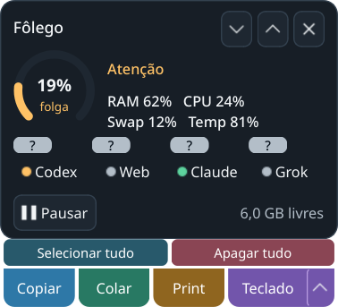

# Hover, franquias e edição de texto — 01/11/2026

Incremento sobre `cb7857479c71c89dc4aa70ebdfce2d26a93708cd`, na branch/PR de
continuidade. [Guia do usuário](../../../COMPACTO.md).

## Causas e resultado

O widget não recebe foco, mas não habilitava `WA_AlwaysShowToolTips`; o Qt não
mostrava suas dicas enquanto outra janela estava ativa. Atributo aplicado no
widget e no teclado. As dicas agora separam uso/reposição de janela, tickets de
reposição, créditos/uso extra e referência mensal. Botão direito abre atualização,
detalhes com rolagem, configuração mensal própria e página do provedor.

Codex: GETs dos mesmos endpoints usados pelo cliente oficial, sem resgate ou
refresh de login. [Implementação de referência da OpenAI](https://github.com/openai/codex/blob/main/codex-rs/backend-client/src/client/rate_limit_resets.rs).
Descoberta e deduplicação de diretórios nativos ativos, restritas ao HOME
selecionado. Fallback limitado aos registros locais. Credencial alterada durante
a consulta invalida a resposta. Não se converte semana em janela de sessão nem
presença de refresh token em data de cobrança.

Claude: uso extra e perfil da assinatura ativa quando disponíveis; referência
mensal pelo dia inicial é identificada como estimativa. Cache em memória de
observações sanitizadas, ligado ao hash da credencial/diretório, sem tokens
persistidos. Uso é consultado no máximo a cada 5 minutos; perfil aceito por 6 h.
HTTP 429 respeita `Retry-After`, inclusive superior a uma hora e formato de data;
somente leitura recente da mesma conta pode ser reaproveitada. Cota vencida é
revalidada em tela e na saída da CLI.

Os GETs reais do Codex retornaram janelas e tickets em três raízes. O perfil real
do Claude foi lido; a consulta posterior de uso respondeu HTTP 429. Essa
indisponibilidade não foi declarada sucesso nem convertida em percentual. O
[registro sanitizado](live-fields.json) contém somente disponibilidade de campos,
sem valores de franquia, identidades, caminhos de conta ou credenciais.

Web/Grok continuam sem fonte verificável de percentual/reposição/tickets nesta
integração. Não se usa consumo de tokens de uma conversa como franquia do plano.
O Grok oferece esses dados na sua interface de uso; [documentação do provedor](https://docs.x.ai/grok/faq).
A opção de abrir o site permite consultá-los, e a referência mensal pessoal pode
ser salva em configuração própria. Esses são limites remanescentes, não gates
verdes para todas as funções dos quatro serviços.

## Edição e encerramento

Selecionar tudo/Apagar tudo ficam numa linha fina, conservando largura de 280 px.
Somente o campo editável em foco do processo local ativo pode ser alterado.
AT-SPI é carregado sob demanda pelo adapter, sem Qt no core/CLI, sem ler texto,
copiar seleção ou enviar atalhos a terminais/arquivos. Identidade, foco, estado
editável e tamanho são revalidados; resultado incerto não gera retry.
[Contrato nativo de apagar texto](https://gnome.pages.gitlab.gnome.org/at-spi2-core/libatspi/method.EditableText.delete_text.html).

Na instância real antiga, Sair fechou o widget com a central já oculta, mas deixou
o loop Qt e o flock vivos. [Regressão antes da correção](quit-before-fix.log): o
watchdog precisou encerrar o loop, code 10. O caminho normal de shutdown agora
solicita também `QGuiApplication.quit()`. A regressão usa um processo Qt próprio
e não encerra serviços/daemons da sessão de trabalho.

## Evidência e limites

`./dev check` final, Python 3.14.7 gerenciado, HOME/XDG/TMP privados, sequencial:
[headless](headless-pytest.log) **1095 passed, 2 skipped**, 20,83 s;
[Qt](gui-pytest.log) **1356 passed, 2 skipped**, 39,30 s. Os skips continuam
dependendo do Edge real. A suíte inclui saída real do loop Qt sem watchdog após
a correção. [Manifesto das fontes e testes](source-hashes.json).

Roteiro: `.dev/venv-gui/bin/python tools/verify_compact_ui.py --input --state
.scratch/ai-details-native-20261101-final`. [Recibo](native-result.json).

KDE/Wayland real, HOME/XDG/TMP próprios: dica com tickets, reposição e mensalidade
via evento de ajuda Qt em widget que não recebe foco; teclado embaixo → topo →
embaixo com geometria confirmada; tecla, seleção inteira e remoção em campo
próprio, com foco preservado. A prova do hover usa evento Qt, não movimento físico
do mouse. A edição foi AT-SPI de produção, sem substituição por teclado global.

Captura `QWidget.grab()`, não screenshot do compositor. O recibo registra 280 ×
275 px no estado sintético; alertas/feedback podem ampliar a altura. Não certifica
todas as aplicações editáveis, terminais sem AT-SPI, compositor X11 ou soak.

As falhas intermediárias do cache foram reproduzidas por testes e preservadas
integralmente. A chave de identidade estava sendo substituída pela variável do
loop de janelas; corrigida sem mudar limites ou remover a regressão. O wrapper
de QA também passou a remover variáveis nativas de caminho dos provedores; um
HOME privado não deve herdar autenticação do HOME físico. Workspaces revisados
foram preservados em `.scratch/dev-tests-reviewed`, sem excluir payloads.

O código desta rodada fica no PR; a tag/release v0.2.0b1 continua inalterada.
Os limites e defeitos gerais de recursos permanecem no [handoff](../../../HANDOFF.md).

Após os gates, a instância antiga já havia fechado o widget pelo botão Sair,
mantendo o processo por causa do defeito reproduzido. SIGTERM único por pidfd,
com argv/starttime e liberação do flock conferidos. `./dev gui` abriu a nova
versão; modo widget acionado por AT-SPI, dois novos botões visíveis e campos de
tickets/mensalidade presentes nos quatro indicadores. [Recibo](restart.json).
Widget reposicionado dentro da área disponível, sem mudar regras KWin ou
grants. Deixado aberto para validação do usuário; nenhum agente foi encerrado.

## Complemento: referência PhaseZero e organização Claude

O caminho informado pelo usuário foi examinado como referência. Fonte:
`PhaseZero/linux/ai/quota_meter.py`, revisão
`53d62e2d14f7edafe5cefea77f46fb0a7dca5cc0`. Ali, Web conta mensagens locais
em 3/24 h; Grok usa uma data mensal pessoal. Nenhum dos dois fornece ali
percentual de franquia. O Fôlego continua sem dependência de código/estado do
PhaseZero.

A comparação encontrou uma proteção adicional aplicável: metadados nativos
`oauthAccount` de `~/.claude.json` participam da identidade do cache. A
[reprodução na base](claude-context-baseline.json) mostrou 90% herdados de A ao
selecionar B (esperado 40%), mesmo sem trocar a credencial. O Fôlego agora
descarta uso/perfil antigos quando esse contexto muda; também descarta resposta
se a troca acontecer durante HTTP. Metadata ilegível não vira contexto vazio.
O prazo de HTTP 429 é conservado para o mesmo token, inclusive A → B → A, sem
reutilizar cotas de outra organização ou contornar a espera do servidor.

Quatro regressões próprias e `./dev check` final:
[headless](claude-context-headless.log) **1099 passed, 2 skipped**, 18,25 s;
[Qt](claude-context-gui.log) **1360 passed, 2 skipped**, 32,86 s. HOME/XDG/TMP
privados, suítes sequenciais, sem trocar conta/organização ou credencial real.
[Manifesto desse complemento](claude-context-source-hashes.json); o manifesto
anterior continua descrevendo o incremento anterior. Falha intermediária de
retenção do prazo no novo contexto foi preservada e corrigida, sem retirar o teste.

Nesta reabertura, o comando **Sair do Fôlego** do menu nativo da bandeja encerrou
normalmente a GUI e seu próprio `ydotoold`; processo e flock acompanhados até a
saída, sem sinal. A GUI oficial foi aberta uma vez e deixada no modo compacto.
[Recibo](claude-context-restart.json). A inspeção AT-SPI do plugin não respondeu;
foi cancelada sem ação, usando depois a interface DBusMenu da própria aplicação,
com PID/identidade do owner conferidos. Nenhum agente/serviço alheio interrompido.
