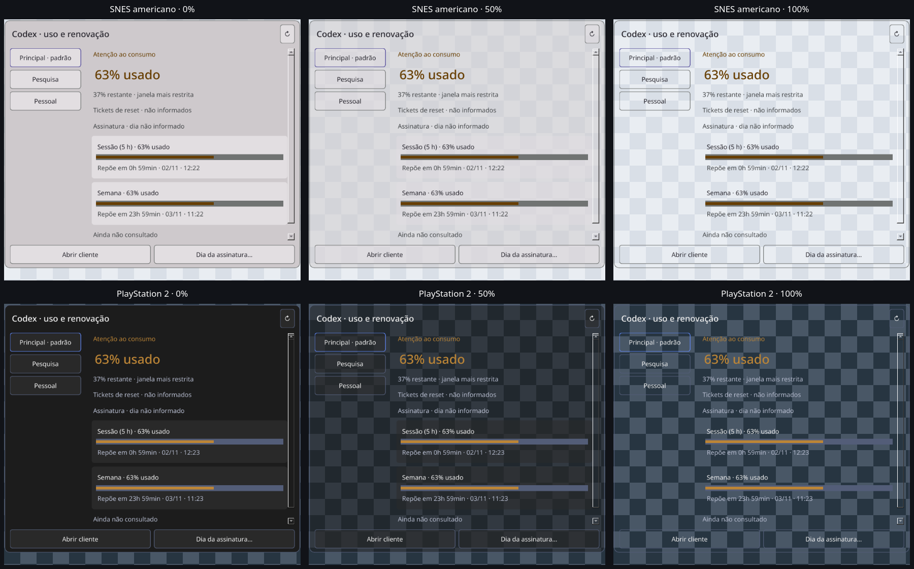
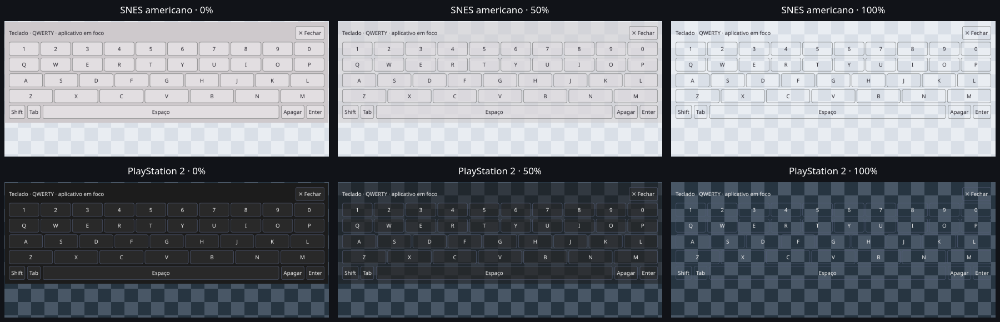

# Fundo contínuo e transparência — 02/11/2026

Painel de contas corrigido: seletores de QWidget/QFrame pintavam também
rótulos e contêineres, produzindo caixas independentes. Agora há uma superfície
contínua com cantos arredondados, filhos transparentes e popup sem moldura preta.
Cartões de janela de uso continuam delimitados, sem pintar os seus rótulos.

Em **Central → opções → Aparência · consoles clássicos**, a barra vai de
**0% opaco** a **100% sem fundo**. Padrão 0%, preferência persistente
`appearance/background_transparency` no QSettings existente. Arrastar dá prévia
sem gravações; soltar salva uma vez. Teclado/acessibilidade também salvam.
Tema preserva o valor; preferência inválida é informada sem sobrescrever.
Falha de gravação restaura a aparência anterior e informa a falha.

Pinturas de fundo recebem alpha; textos, ícones, contornos de teclas, faixas e
indicadores preservam opacidade. Opacidade da janela inteira continua **1**.
Superfícies ARGB preparadas antes do mapeamento; raízes translúcidas pintam o
QSS explicitamente, pois WA_TranslucentBackground suprime o preenchimento
automático. Diálogos, menus, central, compacto, prompts, contas e teclado seguem
a autoridade de tema. Marcação desmarcada mantém contorno visível.
[Referência oficial Qt](https://doc.qt.io/qt-6/qwidget.html#creating-translucent-windows).

## Validação

- `./dev check`: **1168 passed, 2 skipped** headless, 50,68 s; primeira suíte Qt
  **1473 passed, 2 skipped**, 142,25 s. Depois de acrescentar o contorno de checkbox
  desmarcado e sua regressão: `./dev test` **1478 passed, 2 skipped**, 126,64 s.
  Python 3.14.7 gerenciado, sequencial, HOME/XDG/TMP/Pulse privados. Host com
  outros trabalhos ativos, carga observada 18–20; nenhuma carga alheia encerrada.
  [Headless](headless.txt) · [Qt final](qt.txt).
- Focados finais: **15 passed**, 3,84 s; cobrem alpha 0/128/255, texto opaco,
  rótulos sem camada extra, teclado, diálogos, persistência, chave inválida,
  prévia sem gravação, salvamento por gesto e rollback, checkbox distinto e
  ações primárias a 0/100%. Os últimos dois casos validam a aplicação do mesmo
  alpha também no preenchimento primário/hover, após a suíte Qt final. [Focados](focused.txt).
- `tools/verify_window_navigation.py --background-transparency --transparency-theme
  snes-us` e `... --transparency-theme ps2`: duas execuções **aprovadas, sete
  cenários cada**, dentro do orçamento original de 45 s. Três valores por tema,
  central/widget/prompts/contas/teclado, salvamento, navegação e saída, com clique
  nativo no seletor e teclas Qt na barra. [Claro](native-light.json) · [Escuro](native-dark.json).
- `tools/verify_translucent_surface.py --hold-for-capture`: janela Wayland ARGB
  de **8 bits alpha**, fundo medido **255/128/0** e opacidade da janela **1**.
  Painel e fundo quadriculado inteiramente próprios, sem dados de usuário.
  [Resultado](compositor-result.json).
- Captura real via portal no KDE, com 50%: dois pixels coincidem exatamente com
  a mistura calculada (33,40,46 e 50,57,65). [Prova numérica](blend-pixels.json)
  e [recorte físico controlado](compositor-owned-crop.png). O portal usou limites
  lógicos contra pixels físicos na escala de 135%; retidos somente 890×570 px
  dentro do fundo próprio, descartando a borda esquerda da captura. É uma vista
  parcial para conferir a composição; enquadramento completo está nas capturas Qt.

Tentativas anteriores preservadas em `.scratch/background-transparency`,
`.scratch/transparency-native-20261102-*` e `.scratch/translucent-compositor-20261102-*`.
A primeira inspeção de QWidget filho acrescentava uma camada sintética de
paleta; o oráculo passou a medir o popup nativo, com os mesmos valores exigidos.
Uma execução com ambos os temas excedeu o watchdog e não foi aprovada; os dois
perfis finais foram rodados separadamente, sem ampliar limites. QA e auxiliares
encerrados. Sem textos/clipboard/processos pessoais como fixtures ou mudanças
em serviços/dispositivos do host.

## Revisão visual

Comparações compostas a partir das capturas Qt RGBA sobre quadriculado de QA,
para mostrar transparência; não são capturas do desktop do usuário.
[Barra nas opções](options.png). Painel uniforme, sem faixas pretas ou caixas
em rótulos; textos e teclas permanecem visíveis. Composição real conferida na
prova física acima. Leitura em fundos arbitrários depende da combinação com o
tema escolhido; contraste das paletas é medido sobre suas superfícies opacas.

Sem novo release, merge, grant ou executor automático. Não certifica outros
compositores, todos os aplicativos, leitores de tela ou soak de duas horas.

## Host atualizado

Código em `c28b8d4eedd763fb72b82922f87c1e6f6d4aa87e`. GUI anterior encerrada
normalmente pela própria bandeja, lock liberado e `./dev gui` solicitado uma vez.
Nova GUI **566678**, starttime **7014963**, compacto (2702;32,885), 280×219,
central oculta. Posição e tema atuais preservados, sem sinais manuais ou outros
clientes encerrados. Recibo privado `.scratch/background-transparency/replacement.json`;
revalidar identidade/boot. Próximo passo: usuário ajustar a barra nas opções.
