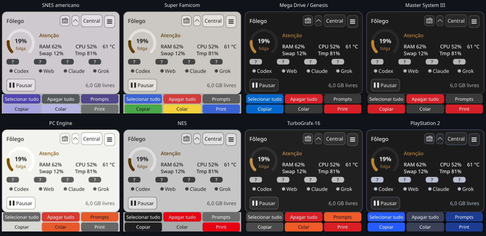
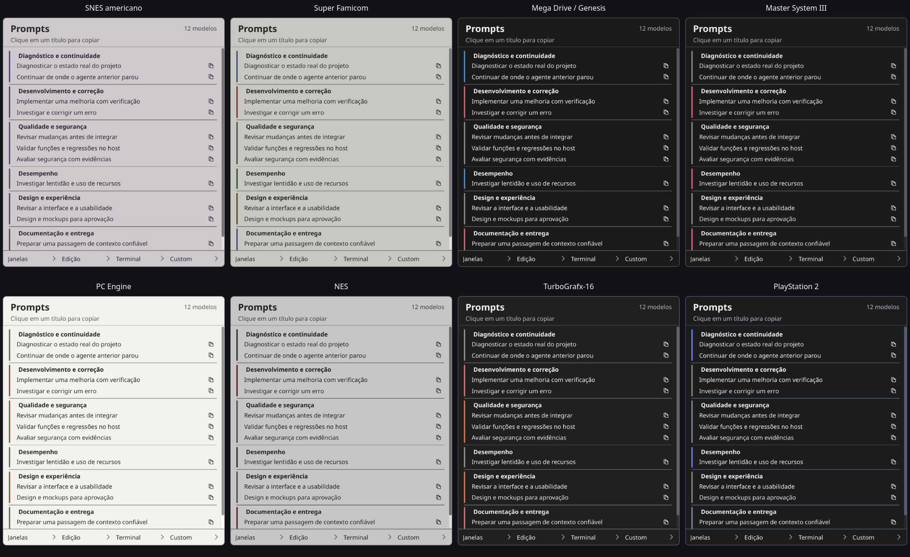
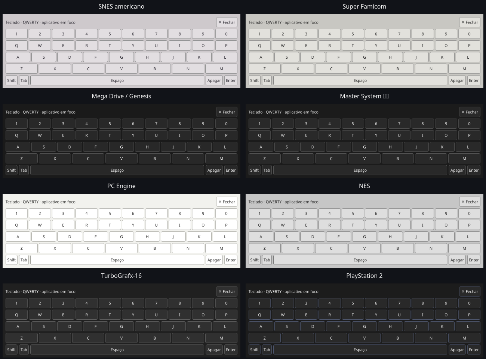

# Temas de consoles — 02/11/2026

Oito referências fornecidas pelo usuário: SNES americano, Super Famicom,
Mega Drive / Genesis, Master System III, PC Engine, NES, TurboGrafx-16 e
PlayStation 2. Aproximações cromáticas, sem logos/assets de consoles.
Cores complementares e tintas ajustadas para legibilidade.

Seletor em **Central → opções → Aparência · consoles clássicos**, com amostras,
descrição e resultado do salvamento. SNES americano é o padrão sem preferência.
Escolha persistente na autoridade QSettings `folego/folego`, chave
`appearance/theme`. Tema desconhecido é informado sem sobrescrever a chave;
falha de gravação mantém a aparência atual e mostra a falha.

Uma autoridade de tokens mantém os imports existentes atualizados. Receitas de
estilo pertencem aos próprios widgets: a troca atualiza superfícies abertas,
ocultas e futuras, controles e ícones. Não recria o app, editores ou monitores.
Cobre central, compacto, prompts/submenus/Custom, contas e teclado. Alertas
mantêm verde/âmbar/vermelho e texto; presentes continuam verdes.

## Verificação

- Focados finais: **46 passed**, 16,09 s. Contraste mínimo 4,5:1 de texto normal,
  semântico e categorias nas três superfícies de cada tema; tinta dos botões
  conforme o fundo; foco distinguível. Persistência/restauração, chave inválida,
  falha de gravação, múltiplas views e superfícies ocultas/futuras.
- `./dev check`: **1168 passed, 2 skipped** headless (48,15 s) e **1465 passed,
  2 skipped** Qt (120,81 s), Python 3.14.7 gerenciado, sequencial,
  HOME/XDG/TMP/Pulse privados. [Headless](headless.txt) · [Qt](qt.txt) · [Focados](focused.txt).
- `tools/verify_window_navigation.py --state .scratch/console-themes-native-20261102-d
  --console-themes`: **12 cenários KDE/Wayland**. Clique nativo no seletor e
  navegação Qt no seu popup, oito temas selecionados/salvos, capturas de quatro
  superfícies por tema, Central/Voltar e saída explícita. [Resultado](native-result.json).
  Somente janelas/dados próprios, sem clipboard/textos/processos do usuário como
  fixtures. Teclado exercitado na apresentação; não reexecutados efeitos de
  digitação/captura/volume neste incremento de cores. QA e auxiliares encerrados.

Baseline remoto `1cf92789aa10eaad608956cab6d5c9eb4799d82c`: núcleo/CLI verdes,
Qt falhou no teste de pareamento (91 contra 88 px na fonte do runner). Corrigido
no produto por política horizontal que não força a largura mínima do texto,
preservando as três colunas iguais. Asserção não foi afrouxada. Prova anterior:
[job Qt](https://github.com/Misael-art/Folego/actions/runs/41450175169/job/125293145757).

Tentativas nativas anteriores preservadas em `.scratch/console-themes-native-20261102-*`.
O harness passou a usar clique nativo para abrir o seletor Wayland, navegar no
próprio popup e começar em outro tema para observar uma alteração efetiva.
O padrão já selecionado não emite currentIndexChanged. Nenhum gate do produto
foi desativado; guardas de posição/PID preservados. Interrupções não aprovadas.

## Inspeção visual

[Central SNES](snes-us-central.png) · [Central PS2](ps2-central.png).
Capturas de superfícies próprias no KDE/Wayland, agrupadas para comparação.
Dados de RAM/CPU/Tmp e **61 °C** demonstrativos. Leitura, foco, alinhamento,
contraste e continuidade visual inspecionados nos oito temas; a última linha
de prompts pode exigir rolagem, como antes. Menus mantêm rodapé e ícones legíveis.

Não certifica todos os aplicativos, leitores de tela, outros compositores ou
soak de duas horas. Sem novo release, merge, grant ou automação de recursos.

## Host atualizado

Código em `4f64b091e04b62303f5b3848c14b2dee2ce681eb`. GUI anterior encerrada
normalmente por Sair na bandeja, lock liberado e `./dev gui` solicitado uma vez.
Nova GUI **389475**, starttime **6736851**, widget (3108,315;187,814), 280×219,
central oculta. Posição atual preservada, sem sinais manuais/outros clientes
encerrados. Recibo privado `.scratch/console-themes/replacement.json`;
revalidar identidade/boot antes de agir. Consulta ampla de locks interrompida
antes da intenção, sem efeito; verificação restringida ao flock/fdinfo do inode
exato. Próximo passo: usuário selecionar o tema na central.
