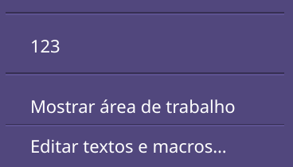
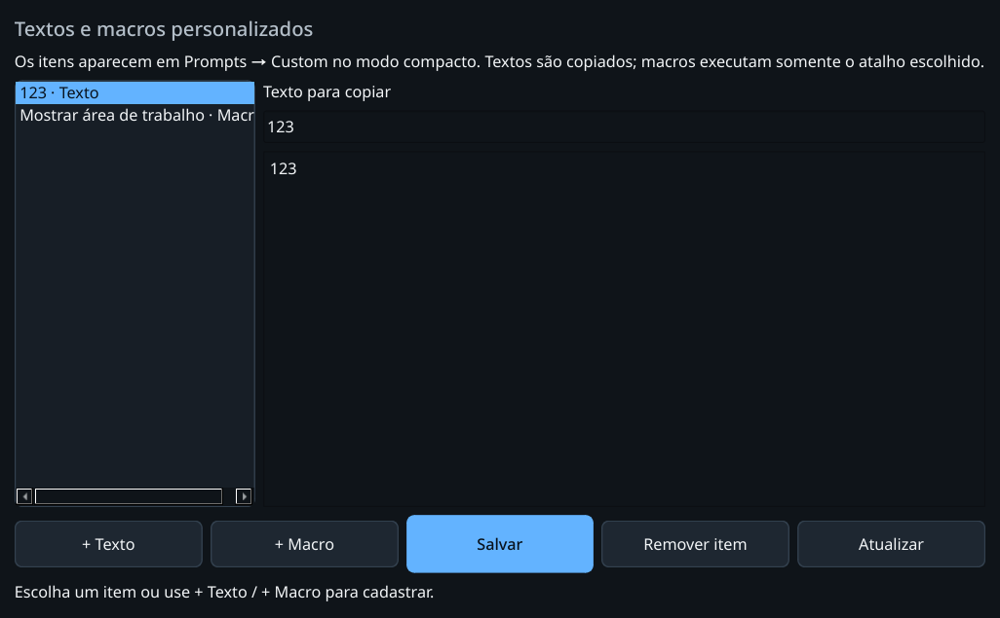
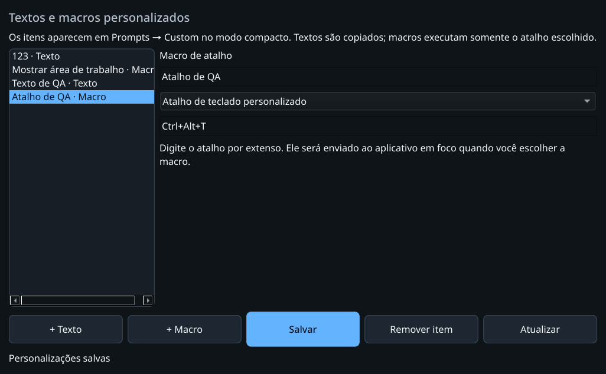

# Textos e macros em Custom — 01/11/2026

Incremento posterior à prévia v0.2.0b2. O último item de Prompts abre Custom;
os exemplos são o texto literal **123**, sem espaços, e **Mostrar área de
trabalho**. A janela principal oferece a aba prompts, + Texto, + Macro,
Salvar, Remover item e Atualizar. A edição não executa macros.

## Contratos verificados

- Arquivo privado e limitado; defaults somente se ausente, vazio persistido
  permanece vazio, JSON/schema desconhecido preservado, symlink/FIFO recusados.
  Revisão impede gravação concorrente e execução por menu antigo.
- Texto copiado na GUI, sem envio automático. Macros aceitam uma combinação de
  teclas ou a ação de desktop do KWin, sem shell. I/O executado em worker;
  core, actions e CLI continuam independentes de Qt.
- A macro de desktop usa a conexão persistente QtDBus do processo. O ensaio
  inicial com qdbus transitório falhou: o KWin restaurava o estado ao encerrar
  o cliente, comportamento confirmado no [código do KWin](https://github.com/KDE/kwin/blob/master/src/dbusinterface.cpp).
  A implementação final envia uma vez e consulta o estado. Já visível não vira
  alternância; estado desconhecido não autoriza o efeito.

## Comandos e resultados

Python 3.14.7 gerenciado; nenhum ambiente global instalado. Suítes sequenciais
com HOME/XDG/TMP privados, Qt offscreen e workspaces exclusivos:

- `./dev test-headless` (fase headless do `./dev check`): **1133 passed,
  2 skipped**, 39,93 s, `run-9s39h2ev`. [Saída](headless.txt).
- `./dev test`: **1402 passed, 2 skipped**, 52,08 s, `run-gjc2ftua`.
  [Saída](qt.txt). Skips existentes exigem Edge real.
- Tentativa inicial: Hypothesis em `test_backup.py::test_roundtrip_property`
  excedeu 200 ms em uma execução e repetiu em 10 ms; teste focado passou sem
  alterar deadline/limites. Outro gate detectou a expectativa antiga da ordem
  das abas (1401 passaram); ela foi atualizada para incluir prompts. As duas
  tentativas anteriores não são consideradas aprovação e estão preservadas.

Com `PYTHONPATH=src .dev/venv-gui/bin/python`:

- `tools/verify_compact_ui.py --state .scratch/custom-ui-native-20261101 --input`:
  **nove casos aprovados** em KDE/Wayland real, incluindo editor e salvamento
  em HOME próprio, painel de contas, teclado nas duas posições, cliques em
  campo próprio e editor descartável separado, selecionar/apagar por AT-SPI.
  Widget **280×275** lógicos. [Resultado](native-ui.json).
- `tools/verify_prompt_clipboard.py --state .scratch/custom-clipboard-native-20261101`:
  prompt integral e Custom **123** copiados e colados em editor próprio no Xvfb.
  Clipboard físico não usado. [Resultado](clipboard.json).
- `tools/verify_custom_macro.py --state .scratch/custom-macro-native-20261101-final`:
  clique nativo nas macros Mostrar área de trabalho e Ctrl+A pelo submenu,
  desktop confirmado, segunda chamada mantém desktop visível e seleção exata
  de 123 no campo próprio. KWin/Xvfb/D-Bus em namespaces privados, HOME/XDG
  isolados antes do daemon, runtime físico oculto e raiz do host somente leitura.
  [Resultado](macros.json). Não minimizou janelas da sessão física.

Registros completos locais em `.scratch/custom-*`; tentativas anteriores da
macro preservadas. Workspaces revisados em `.scratch/dev-tests-reviewed/20261101-custom`.
Screenshots inspecionados visualmente, com conteúdo sintético. As provas não
certificam todos os aplicativos de destino, login X11 físico, outras
distribuições ou sequências de comandos. Não houve reinício de serviço físico,
mudança de grants nem encerramento de clientes de IA neste incremento.
