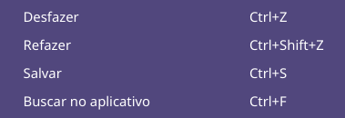
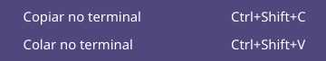

# Dez atalhos padrão — 02/11/2026

Prompts inclui Janelas (alternar aplicativo, visão geral, esquerda/direita),
Edição (desfazer, refazer, salvar, buscar) e Terminal (copiar/colar). Cada item
mostra sua combinação, sem registrar um atalho global no Fôlego. A seleção
envia uma combinação pelo mesmo worker/backend usado pelas macros Custom.
O catálogo Qt-free usa IDs estáveis; item desconhecido não envia teclas.

Os padrões ficam disponíveis também em instalações existentes. Não há migração,
gravação ou acréscimo automático no arquivo privado de Custom. Texto `123`,
Mostrar área de trabalho, biblioteca vazia e dados personalizados são preservados.
Abrir o menu não executa macro. Atalhos de aplicativos dependem do destino;
as quatro associações de Janelas foram conferidas por leitura no KDE deste host.

## Verificação

- `./dev test tests/test_custom_prompts.py tests/test_ui_custom_prompts.py tests/test_ui_desktop_shortcuts.py`:
  **44 passed**, 2,87 s. Os dez IDs enviam uma combinação exata, sem alterar a
  biblioteca; grupos, ordem, ausência de atalhos globais e rejeição de IDs
  desconhecidos cobertos. Custom inválido não bloqueia os padrões.
- `./dev check`: **1162 passed, 2 skipped** headless (28,75 s); **1441 passed,
  2 skipped** Qt (57,80 s). Python 3.14.7 gerenciado, suítes sequenciais,
  HOME/XDG/TMP/Pulse privados. [Headless](headless.txt) · [Qt](qt.txt).
- `.dev/venv-gui/bin/python tools/verify_window_navigation.py --state .scratch/default-shortcuts-native-20261102-c --standard-shortcuts`:
  **dez cenários aprovados em KDE/Wayland real**, sendo quatro de navegação e
  seis de macros. Cliques nativos no menu desfizeram/refizeram texto próprio;
  Salvar, Buscar e os dois atalhos Terminal foram recebidos por bindings Qt no
  alvo próprio, sem gravar arquivos ou tocar no clipboard físico. Foco retornou
  ao alvo após cada escolha. Ponteiro/superfície/PID revalidados antes dos cliques.
  [Resultado](result.json). Não certifica um arquivo salvo nem copiar/colar num
  Konsole real ou executar os quatro atalhos globais de Janelas.
- Tentativas anteriores preservadas em `.scratch/default-shortcuts-native-20261102-*`:
  primeira leitura de QMenu após sua destruição corrigida no oráculo; ponteiro
  fora da posição esperada bloqueou outro clique. A prova final coloca somente
  seu próprio widget numa posição interior e conserva as verificações de PID.
  Nenhum cliente, texto privado, agente, clipboard ou serviço do usuário como fixture.

GUI real substituída por Sair na bandeja e `./dev gui`, com lock liberado, sem
sinais manuais. Novo PID **4071137**, starttime **5940425**, compacto em
(2958,549;116,584), 280×275, central oculta e posição do usuário preservada.
Recibo privado `.scratch/default-shortcuts/replacement.json`; revalidar
identidade/boot antes de agir novamente. QA e seu auxiliar encerrados.
Sem novo release, merge, autostart, grant ou regra persistente neste incremento.
