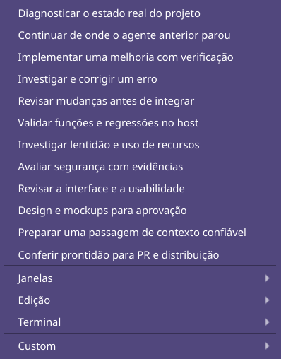

# Prompt de design e mockups — 02/11/2026

Item **Design e mockups para aprovação**, ID `design-mockups`, na lista Prompts,
logo após a revisão de usabilidade. Biblioteca passa de 11 para 12 títulos.
Selecionar copia integralmente o texto fornecido pelo usuário, sem preâmbulo
adicional, execução ou envio automático. Os demais prompts mantêm seu contexto.
Texto embutido no pacote Python, sem dependência do anexo no host.

Integridade UTF-8: **9866 bytes**, SHA-256
`679b411c224337653971fe662e62a854f704a703203310f393c59bed06b0e8a9`.
Inclui as oito etapas, links, restrições e critério final do original.

Verificação proporcional ao incremento de conteúdo:

- `./dev test tests/test_development_prompts.py tests/test_ui_ai_account_panel.py tests/test_ui_custom_prompts.py`:
  **11 passed**, 1,54 s. Integridade integral por hash, 12 IDs únicos, contexto
  dos demais prompts e regressões dos menus/personalizações. [Log](qt-focused.txt).
- `./dev test-headless tests/test_development_prompts.py`: **2 passed**, 0,27 s,
  sem Qt. [Log](headless-focused.txt). Python 3.14.7 gerenciado, sequencial,
  HOME/XDG/TMP/Pulse privados. Não se repetiram as suítes integrais neste lote.
- `.dev/venv-gui/bin/python tools/verify_prompt_clipboard.py --state .scratch/design-prompt-clipboard-20261102-a --prompt-key design-mockups`:
  seleção no menu de produção, clipboard Qt real e Shift+Insert num editor
  próprio em Xvfb. Texto completo e hash idênticos; Custom `123` também preservado.
  Servidor próprio encerrado, clipboard físico intacto. [Resultado](clipboard-result.json).
- `.dev/venv-gui/bin/python tools/verify_window_navigation.py --state .scratch/design-prompt-native-20261102-c --prompt-key design-mockups`:
  **cinco cenários KDE/Wayland** (quatro de navegação mais seleção do prompt por
  clique nativo). Para proteger o clipboard físico, a recepção foi interceptada
  em memória e comparada ao texto completo. Ponteiro/superfície/PID próprios
  revalidados. [Resultado](native-result.json). Screenshot de superfície Qt
  própria, inspecionado visualmente; não captura composta do desktop.

Tentativas nativas anteriores preservadas em `.scratch/design-prompt-native-20261102-*`.
O primeiro clique foi bloqueado por coordenada fora da saída; prova final usa
posição interior somente para seu widget e aguarda escala do popup antes do
clique, mantendo os guardas de PID. Nenhuma regra persistente alterada.

GUI real substituída por Sair na bandeja e `./dev gui`, com lock liberado,
sem sinais manuais. Novo PID **4108311**, starttime **5992098**, widget em
(2958,549;116,584), 280×275, central oculta, posição do usuário preservada.
Recibo privado `.scratch/design-prompt/replacement.json`; revalidar identidade
e boot antes de agir novamente. QA e auxiliar encerrados. Sem release/merge.
