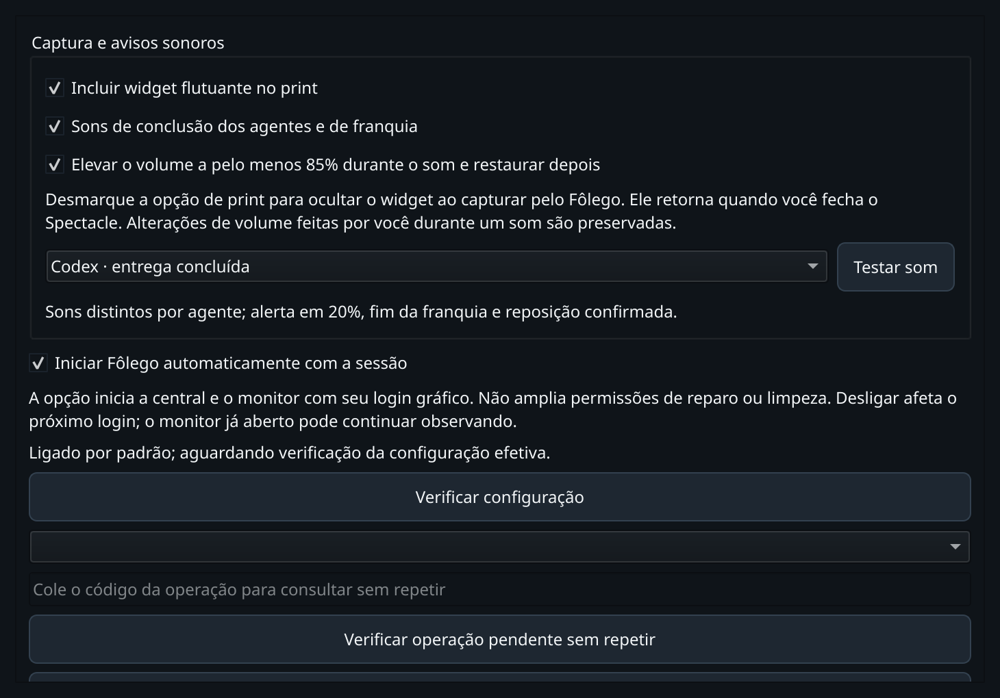

# Edição Chromium, captura e sons — 01/11/2026

Incremento sobre cc2f3bf, na raiz e PR existentes. A correção de edição está em
6396a527c03e1ed7e44a74a7ce5e8f2e942241ee; captura e sons são integrados no mesmo lote.
Não altera a tag publicada v0.2.0b2 nem publica outro release.

## Correção e contratos

O baseline em Chrome próprio reproduziu quatro recusas: campos `entry` com
estados editable/enabled/focused/showing e interface Text, sem EditableText.
O produto agora seleciona o campo por AT-SPI, espera a confirmação da seleção
inteira, revalida foco/identidade/tamanho e envia um Backspace. A preparação da
entrada ocorre antes da última revalidação. Não há Ctrl+A global ou leitura
integral do campo. O terminador de linha de contenteditable vazio é tratado;
mensagem de sucesso exige confirmação. [Interface oficial AT-SPI Text](https://gnome.pages.gitlab.gnome.org/at-spi2-core/libatspi/iface.Text.html).

Print mantém o widget por padrão. A preferência desmarcada oculta widget e
teclado antes de abrir o Spectacle, observa o filho criado e restaura após seu
encerramento/cancelamento. A posição Wayland usa a integração KWin existente,
restrita às janelas do próprio PID e confirmada por geometria; restaura o teclado
com nova confirmação de posição/foco. Falha de abertura restaura a interface.
Não controla Print externo nem fecha uma captura que o usuário esteja editando.

O monitor de IA é compartilhado pela central e widget: ocultar a janela não
desliga os avisos. Quatro melodias de conclusão e três de franquia são PCM
originais, sintetizadas sem assets/dependências novas. Transições confirmadas
por conta disparam 20%, zero e reposição. Dados vencidos/desconhecidos não criam
alertas. Baseline ignora entregas antigas, mas aceita a primeira conclusão nativa
posterior à abertura mesmo que o provedor antes estivesse indisponível.

Áudio é serializado e limitado; pode ser desligado em opções, com preview
explícito. Volume temporário de pelo menos 85%, desmute, intenção privada antes
do efeito, identidade do servidor/saída, restauração exata por canal/mudo e
preservação de ajuste concorrente do usuário. Registros pendentes são reconciliados
por evidência; outro boot/servidor/saída bloqueia restauração incerta.

## Validação

Python 3.14.7 gerenciado, suites sequenciais, HOME/XDG/TMP privados; o wrapper
também separa o servidor Pulse físico dos testes offscreen. Nenhuma instalação
global ou novo serviço físico:

- `./dev check`: **1148 passed, 2 skipped** headless, **29,23 s**, `run-dm_5s24s`;
  **1422 passed, 2 skipped** Qt, **52,45 s**, `run-36rfjt__`.
  [Headless](headless.txt) · [Qt](qt.txt). Skips existentes exigem Edge real.
- `PYTHONPATH=src .dev/venv-gui/bin/python tools/verify_editable_chromium.py --state .scratch/cdel5`:
  **quatro casos aprovados**, textarea e contenteditable com estado controlado,
  com/sem seleção. DOM verificado depois da reconciliação do editor; texto e
  estado ficaram vazios. Chrome, perfil e HTML próprios; nenhum campo do Codex
  do usuário foi alterado. [Resultado](chromium.json).
- `PYTHONPATH=src .dev/venv-gui/bin/python tools/verify_compact_ui.py --state .scratch/capture-sound-ui-20261101-e --input --capture`:
  **11 casos aprovados** em KDE/Wayland real. Inclui hover, teclado com ponteiro,
  edição AT-SPI, editor externo descartável, dois Spectacles próprios cancelados
  sem salvar região, widget desmapeado do compositor na opção desmarcada e retorno
  à posição anterior. Teclado restaurado com confirmação nativa. Largura **280 px**;
  altura varia por feedback. [Resultado](native-ui.json).
- `PYTHONPATH=src .dev/venv-headless/bin/python tools/verify_notification_audio.py --state .scratch/aq1`:
  **sete sons aprovados** em PipeWire/Pulse/WirePlumber próprios, saída nula,
  namespaces PID/rede, runtime físico e dispositivos de som ocultos. Antes de
  cada reprodução, canais confirmados em **55706/65536 (85%)**, sem mudo;
  depois, **22937/29491** e mudo originais restaurados. [Resultado](audio.json).
- Testes cobrem falha/timeout, conflito de volume, registro desconhecido, retomada
  de intenção, preferências e caminho entrega → worker de áudio sem replay.
  Uma leitura posterior do registro da instância real confirmou `restored`, mesma
  saída, volume/mudo iguais aos anteriores; nenhum preview físico foi disparado
  pelo QA. [Leitura somente consulta](production-audio.json).
- A instância reaberta apresentou as três preferências marcadas e Testar som por
  acessibilidade nativa. [Prova da GUI](live-gui.json). Screenshot inspecionado;
  a rolagem evita comprimir/cortar os controles na tela do Deck.

Tentativas anteriores preservadas: caminho IPC longo no primeiro Chrome,
sincronização de mapeamento/worker no harness nativo e inicialização de metadados
do servidor de áudio privado. Um teste novo herdou o cache de QSettings de outro
teste; passou a estabelecer sua preferência explicitamente. Nenhuma dessas
tentativas é aprovação; não foram aumentados limites/deadlines ou retirados gates.
Logs completos locais em `.scratch/cdel*`, `.scratch/aq*`, `.scratch/capture-sound-ui-*`
e `.scratch/dev-tests-reviewed/20261101-capture-sounds`.

Não certifica todos os clientes editáveis, hardware/alto-falante físico,
outras distribuições, região final salva ou capturas externas. Use Testar som
para avaliar a identidade/audibilidade no seu dispositivo. Web/Grok sem fonte
de franquia continuam desconhecidos, sem sons percentuais inventados. O executor
automático de recursos e os limites gerais do projeto permanecem como antes.
