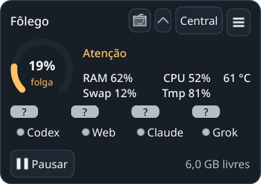
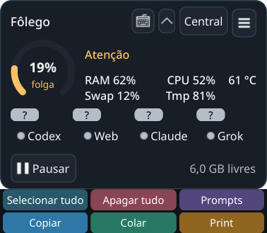

# Atalhos recolhíveis e temperatura — 02/11/2026

Seis botões iguais em duas linhas. Animação descendente de 140 ms, espera de
200 ms ao sair e preservação enquanto menus estão abertos. Teclado compacto
no cabeçalho, abertura padrão embaixo e seta separada para cima. CPU e Tmp
alinhados; °C à direita da CPU. Tmp continua sendo ocupação dos temporários.
Sensores CPU/SoC preferenciais; ACPI identificado como fallback de sistema.
Ausente/ilegível permanece — °C, sem usar GPU/disco como sensor do host.

Capturas de superfícies próprias no KDE/Wayland. Dados demonstrativos de
RAM/CPU/Tmp e **61 °C**, sem tratar a demonstração como medição do host.
Inspeção visual: linhas iguais, textos legíveis, teclado disponível recolhido,
CPU/Tmp alinhados e temperatura à direita sem sobreposição.

## Verificação

`./dev check`: **1168 passed, 2 skipped** headless (21,64 s) e
**1453 passed, 2 skipped** Qt (45,89 s). Python 3.14.7 gerenciado, sequencial,
HOME/XDG/TMP/Pulse privados. [Headless](headless.txt) · [Qt](qt.txt).
Testes cobrem sensores válidos/ausentes/inválidos, preferência CPU sobre GPU,
disco e ACPI, fallback e animação/recolhimento, inclusive Enter sintético.

`tools/verify_window_navigation.py --state .scratch/hover-actions-native-20261102-j
--prompt-key design-mockups --standard-shortcuts`: **12 cenários KDE/Wayland**,
incluindo recolher/revelar, seleção de prompt e seis macros com foco preservado.
Clipboard físico interceptado no QA; efeitos somente em editor/bindings próprios.
[Resultado](native-result.json). QA e auxiliares encerrados.

Tentativas anteriores preservadas em `.scratch/hover-actions-native-20261102-*`.
A prova detectou Enter sintético após fechar popup, sem Leave correspondente ao
entrar em outra superfície da aplicação. O widget observa também Enter de outras
janelas Qt para reconciliar esse caso. Guardas de posição/PID impediram cliques
quando o destino ainda não estava configurado; o harness aguarda assentamento
nativo. Nenhum serviço ou configuração física de entrada foi alterado.

A coleta de temperatura é somente leitura no worker. Sem novos grants, ações
de recursos ou dependências. Não certifica outros compositores, aplicações,
leitores de tela ou soak de duas horas. Release b2 permanece imutável.

## Host atualizado

Código em `ee4a756203d7e1708e0ecda0d31d5383a88195ee`. Instância anterior
encerrada pela própria bandeja, lock liberado e `./dev gui` solicitado uma vez.
Nova GUI **234379**, starttime **6504957**, widget (3108,315;187,814), 280×219,
central oculta. Posição atual do usuário preservada, sem sinais manuais ou
encerramento de outros clientes. Recibo privado
`.scratch/hover-actions/replacement.json`; revalidar identidade/boot antes de
agir. Leitura real confirmou sensor ACPI `acpitz` disponível no host; a captura
acima usa somente dados demonstrativos. Próximo passo: validação do usuário.
