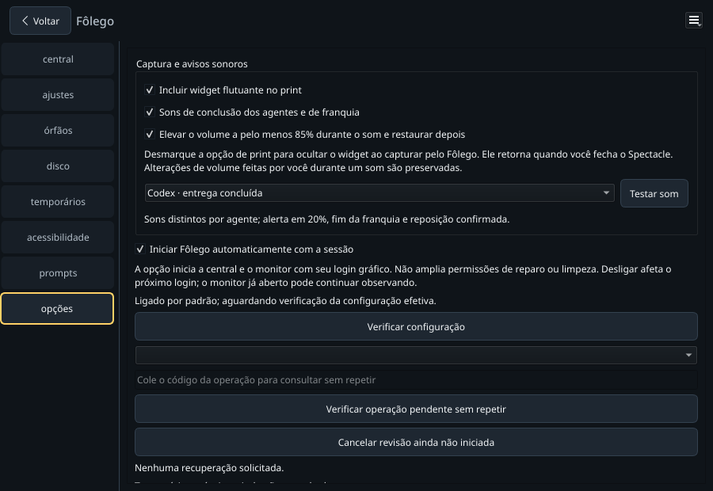
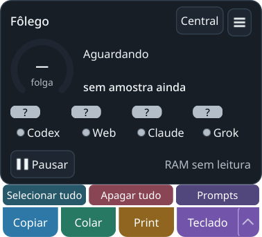
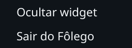

# Voltar e controles explícitos — 01/11/2026

Central sem barra de minimizar/maximizar/fechar, com **Voltar** no cabeçalho.
O botão mostra o widget e oculta a central, mantendo aba e monitoramento, inclusive
sem bandeja. O widget troca os três botões por **Central** e um menu **Controles**.
Sair permanece uma ação explícita do menu ou da bandeja; ocultar preserva uma
rota de retorno. Nenhuma operação de recursos ou grant é criada pela navegação.

## Verificação

- `./dev check`: **1148 passed, 2 skipped** headless, 22,62 s; **1424 passed,
  2 skipped** Qt na primeira execução. Após ajustar a abertura do menu sem foco,
  `./dev test` passou **1424 passed, 2 skipped**, 40,24 s. Remoção apenas visual
  do ícone de Central foi seguida por **51 passed**, 4,50 s, nos testes de janela,
  compacto e encerramento, além da prova nativa final. [Headless](headless.txt) · [Qt](qt.txt).
- Python 3.14.7 gerenciado, suites sequenciais, HOME/XDG/TMP/Pulse isolados.
  Workspaces concluídos revisados e preservados integralmente em
  `.scratch/dev-tests-reviewed/20261101-navigation`. A guarda de 20 sessões
  recusou uma execução antes do pytest; não foi relaxada e nada foi apagado.
- `PYTHONPATH=src .dev/venv-gui/bin/python tools/verify_window_navigation.py --state .scratch/navigation-native-20261101-g`:
  **quatro casos aprovados em KDE/Wayland real**, janelas próprias, sem bandeja,
  fonte de dados controlada, sem credenciais, texto do usuário ou efeitos de
  recursos. Central → Voltar → widget → Central manteve opções selecionada e
  worker ativo; clique nativo em Controles → Sair encerrou o loop Qt e workers.
  Auxiliar de entrada próprio encerrado. [Resultado](result.json).
- KWin 6.7.4 confirmou frame e client iguais (900×620), sem espaço para uma barra
  do compositor. O Qt usa FramelessWindowHint, sem decoração própria. Não foram
  criadas regras persistentes de janela. O cabeçalho pede movimento nativo ao
  arrastar; arraste físico e outro compositor não foram certificados neste lote.

Ensaios anteriores preservados em `.scratch/navigation-native-20261101-*`.
O primeiro oráculo usava `noBorder`, mas no KWin atual ele representa a política
de decoração, não a presença da moldura: [implementação oficial](https://github.com/KDE/kwin/blob/master/src/window.cpp).
A prova foi corrigida para comparar as geometrias observadas. Ensaios de ponteiro
também passaram a usar a origem real do compositor, pois coordenadas globais Qt
não são garantidas no Wayland. Cliques fora do PID próprio foram bloqueados.
No widget sem foco, o menu passou a abrir após soltar o botão, pelo mesmo padrão
de popup usado em Prompts; o clique nativo final confirmou abertura e saída.

Screenshots são das superfícies Qt próprias, com dados de teste, inspecionados
visualmente. Não são capturas compostas do desktop nem prova de outros clientes,
hardware ou soak. Os limites gerais do projeto continuam no HANDOFF.
