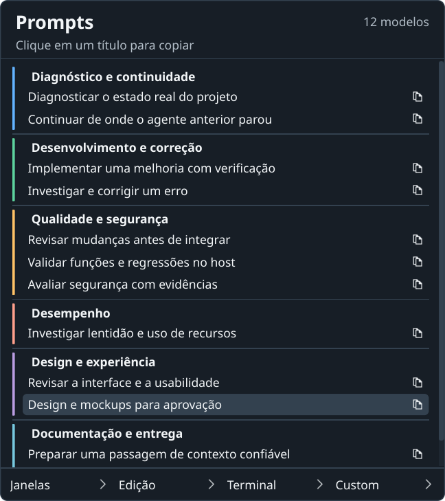

# Seletor por categorias — 02/11/2026

Implementação Qt da opção aprovada **Blocos com faixa lateral**. Doze títulos
em seis grupos, cores e cabeçalhos horizontais, ícone de copiar por linha e
rodapé fixo com Janelas/Edição/Terminal/Custom. Painel de até 480 × 540 px,
rolagem, títulos completos e navegação por setas/Tab/Enter/Escape.
Conteúdo dos prompts e biblioteca privada preservados. Sem novos grants,
atalhos globais, dependências Python ou regras persistentes.

## Validação

- Focados finais: `./dev test tests/test_development_prompts.py tests/test_ui_prompt_panel.py tests/test_ui_custom_prompts.py tests/test_ui_desktop_shortcuts.py`:
  **20 passed**, 5,61 s, após corrigir herança de estilos e layout.
- `./dev check`: **1165 passed, 2 skipped** headless, 21,16 s; **1448 passed,
  2 skipped** Qt, 44,62 s. Python 3.14.7, sequencial, HOME/XDG/TMP/Pulse privados.
  [Headless](headless.txt) · [Qt](qt.txt). Sessões focadas concluídas revisadas e
  movidas intactas para `.scratch/dev-tests-reviewed/20261102-prompt-groups`.
- `.dev/venv-gui/bin/python tools/verify_window_navigation.py --state .scratch/prompt-groups-native-20261102-e --prompt-key design-mockups --standard-shortcuts`:
  **onze cenários aprovados KDE/Wayland**; prompt por clique nativo, seis macros
  de Edição/Terminal com retorno do foco, navegação e saída. Salvar/Buscar/Terminal
  recebidos por bindings Qt próprios, sem arquivo/clipboard físico como fixture.
  [Resultado](native-result.json).
- `tools/verify_prompt_clipboard.py --state .scratch/prompt-groups-clipboard-20261102-a --prompt-key design-mockups`:
  clipboard Qt real e Shift+Insert em editor/Xvfb próprios, 9866 bytes e SHA-256
  `679b411c224337653971fe662e62a854f704a703203310f393c59bed06b0e8a9` idênticos
  ao texto fornecido; Custom `123` preservado. [Resultado](clipboard-result.json).
- `tools/verify_custom_macro.py --state .scratch/prompt-groups-custom-20261102-a`:
  Mostrar área de trabalho, repetição sem desfazer e macro personalizada por
  clique no novo rodapé, em KWin/Xvfb/D-Bus próprios, namespaces e runtime físico
  oculto. [Resultado](custom-result.json). Servidores/auxiliares encerrados.
- Wheel construído offline com uv gerenciado: **386883 bytes**. Módulos e assets
  do pacote comparados byte a byte com a fonte; SVGs e licença presentes, sem
  `.dev`/`.scratch`. [Recibo e hash](package-result.json). É prova de empacotamento,
  sem novo release ou upload de artefato. A tag v0.2.0b2 publicada é imutável.

## Revisão visual e fontes

[Relatório de QA](../../../../design-qa.md), [comparação final](comparison-final.png)
e [detalhe](comparison-design-detail.png) foram inspecionados após o refinamento.
As capturas são de superfícies Qt próprias; não são captura composta do desktop.
O último título pode exigir rolagem com a fonte nativa, preservando altura e
legibilidade. Não certifica todos os leitores de tela/aplicativos/compositores.

Ícones do tema nativo, com fallback Tabler original e licença MIT em
`src/folego/ui/icons/`. Fonte: [Tabler Icons](https://github.com/tabler/tabler-icons),
arquivos `icons/outline/copy.svg` e `icons/outline/chevron-right.svg`, obtidos em
02/11/2026; hashes e licença acompanham os arquivos. Não há download no runtime.

Tentativas anteriores preservadas em `.scratch/prompt-groups-native-20261102-*`.
O guard de ponteiro bloqueou cliques quando a posição não foi confirmada. O
harness passou a entrar na altura comum das saídas, cruzar horizontalmente e
revalidar Y após a mudança de escala entre monitores. Mantidos guardas de
coordenadas e PID; não foram alteradas configurações ou dispositivos do host.
