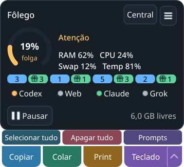

# Redefinições disponíveis no widget — 02/11/2026

Presente verde ao lado da contagem azul de entregas, na mesma linha de 14 px,
sem aumentar os 280 px lógicos do widget. Soma tickets confirmados das contas
do provedor; 9+ preserva espaço e o tooltip informa o número exato e as contas.
O clique abre uma conta com tickets (preferindo a padrão), sem resgate. Hover
no nome do provedor continua na conta padrão. A cor de cota não é agregada.

Um QTimer compartilhado alterna opacidade 1/0,5 a cada 800 ms; não há fase
totalmente invisível. Ocultar/encerrar para o timer. Dado ausente, futuro,
malformado, com mais de 15 minutos ou com primeira expiração conhecida vencida
não gera presente. O núcleo, a CLI e o painel usam a mesma verificação.
Uma janela de uso que se repõe automaticamente não é um ticket. A fonte
atualmente confirmada de tickets é Codex; o mesmo componente aceita os quatro
provedores quando houver observação confirmada, sem fabricar dados para eles.

## Verificação

- `./dev test tests/test_ai_sessions.py tests/test_ui_desktop_shortcuts.py tests/test_ui_ai_account_panel.py`:
  **43 passed**, 2,02 s. Inclui dados inválidos/vencidos, validade sem decremento
  presumido, contas múltiplas, independência das entregas, limite 9+ e ciclo de vida.
- `./dev check`: **1151 passed, 2 skipped** headless (28,95 s), **1429 passed,
  2 skipped** Qt offscreen (49,21 s). Python 3.14.7 gerenciado, HOME/XDG/TMP/Pulse
  privados, suítes sequenciais. [Headless](headless.txt) · [Qt](qt.txt).
- `.dev/venv-gui/bin/python tools/verify_compact_ui.py --state .scratch/reset-gifts-native-20261102-f --reset-badges-only --input`:
  **cinco cenários em KDE/Wayland real**: quatro indicadores sem sobreposição,
  quantidade de múltiplas contas, timer real claro/atenuado/claro, ocultar/voltar,
  clique nativo em presente levando à conta secundária e invalidação por validade
  e zero sem apagar entregas. Ponteiro e superfície/PID próprios revalidados antes
  do clique. Nenhum ticket, credencial, clipboard ou campo do usuário como fixture.
  Auxiliar de entrada do QA encerrado. [Resultado](result.json) ·
  [Fase atenuada](compact-gifts-dim.png) · [Conta escolhida](reset-account.png).
- A inspeção inicial encontrou o min-height global de botões cortando o presente;
  o botão agora sobrescreve esse mínimo e um teste inclui o tema do produto.
  Tentativas anteriores ficam em `.scratch/reset-gifts-native-20261102-*`.
  Clique programático sem serial de ponteiro não aprovou popup no Wayland;
  a prova final usa clique nativo. O harness aguarda escala fracionária e processa
  DeferredDelete antes de capturar a conta, evitando fotografar labels antigos.
- Duas sessões focadas concluídas foram revisadas e movidas intactas para
  `.scratch/dev-tests-reviewed/20261102-reset-gifts`. Sem apagar evidência ou
  ampliar os limites do wrapper.

Instância real substituída por **Sair do Fôlego** na bandeja, lock liberado e
`./dev gui`, sem sinal manual ou encerramento de outros aplicativos. Recibo
privado `.scratch/reset-gifts/replacement.json`. GUI nova PID 3445610, starttime
5247515; compacto em (2804,553;185,362), 280×275, central oculta. A identidade
deve ser revalidada antes de qualquer ação futura. Sem release/merge neste lote.

Screenshots são renders das superfícies Qt próprias, com dados sintéticos,
inspecionados visualmente. Não certificam todos os endpoints de provedores,
resgate, outros compositores ou uma captura composta do desktop. O QA não
alterou contas, som, serviços físicos, regras persistentes ou grants.
