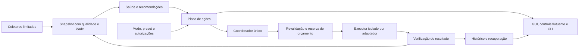

# Arquitetura e presets para um Fôlego residente

A evolução proposta tem três responsabilidades: observar a pressão do host, identificar recursos com procedência suficiente e executar apenas ações compatíveis com a autorização vigente. A interface, a CLI e a automação devem consumir o mesmo motor. Nenhuma delas decide sozinha que um processo pode morrer ou um diretório pode ser apagado.

O primeiro alvo continua sendo Linux com KDE, validando X11 e Wayland. A generalização para outras distribuições depende da detecção de capacidades. Windows/WSL, macOS e outros gerenciadores de VM ficam atrás de adaptadores futuros; esta proposta não presume portabilidade das leituras de `/proc`.

## Fluxo de decisão

Preservar `core`, `actions`, `safely`, `process` e `ui`. Acrescentar contratos pequenos, com nomes finais ajustáveis durante a implementação:

| Módulo proposto | Responsabilidade |
|---|---|
| `core/health.py` | Saúde por recurso, duração, qualidade, histerese e recomendações explicáveis |
| `core/capabilities.py` | Linux/kernel, cgroups, PSI, XDG, Qt, compositor e gerenciadores disponíveis |
| `core/resources.py` | Identidades estáveis de arquivos, processos, volumes, sessões e recursos virtuais |
| `policy/` | Presets versionados, grants, limites, exclusões e decisões puras |
| `orchestration/` | Plano, fila, trava, execução, cancelamento, verificação e recuperação |
| `sessions/` | Registro de agentes, heartbeat, posse de artefatos e encerramento de sessão |
| `adapters/` | Filesystem, processos, Git, caches, containers, libvirt e futuras plataformas |
| `store/` | Transações de operações e migração de JSONL/manifests existentes |
| `ui/components/` | Indicadores, lista de ações, resumo de impacto, tema e estados compartilhados |
| `ui/floating_control.py` | Controle compacto que envia pedidos ao mesmo coordenador |

Começar com o coordenador no processo controlador atual e executores isolados. Separar um serviço de usuário independente da GUI somente quando houver necessidade comprovada de continuar após fechar toda a interface ou de reduzir o custo da janela residente. Não lançar um processo Python novo para cada métrica a cada dois segundos.

## Contrato de uma operação

Cada plano deve conter `schema_version`, `plan_id`, digest canônico, instante de criação, validade, versão/hash da política, qualidade do snapshot, origem do pedido e lista de ações. Cada ação traz:

- Adaptador, operação, alvo com identidade, justificativa e evidências de elegibilidade.
- Risco, reversibilidade, pré-condições, impactos possíveis e capacidade de cancelamento.
- Estimativa de bytes lógicos/alocados, reserva de destino e custo máximo de I/O/tempo.
- Autorização exigida e mecanismo de restauração, quando existir.
- Relações de dependência e chave de idempotência.

Identidade de processo: boot ID, PID, starttime, UID, executável observado, sessão/unidade/cgroup e, quando disponível, pidfd. Identidade de arquivo: mount ID, device, inode, tipo, owner, versão observada/mtime e raiz resolvida. Caminho ou PID isolado não é identidade suficiente. Interfaces precisam tolerar “não disponível” e reuso entre boots.

O executor aceita um plano confirmado ou um grant persistido, **não apenas um booleano genérico**. Revalida identidade, política, evidências de uso, espaço e limites sob uma trava interprocessos. Se a alteração mudar o conjunto de alvos, o risco ou exceder a autorização, invalida o plano e apresenta outro. Sugestão inicial de validade: 30 s para processos e 5 min para inventários de disco, sempre com revalidação; valores serão calibrados em uso real.

Estados persistidos: `planned`, `authorized`, `prepared`, `running`, `verifying`, `succeeded`, `partial`, `failed`, `cancelled`, `needs_recovery`. Timeout não equivale a falha sem efeitos. Duplicar o clique, reabrir a GUI ou reenviar o mesmo `operation_id` consulta o resultado, não repete a mutação.

Cancelamento impede próximas ações e aguarda um ponto seguro na ação corrente. Em uma cópia, preservar a origem e identificar o destino parcial. Em um pedido de encerramento já enviado, explicar que não há desfazer. Após reinício, reconciliar efeitos reais antes de oferecer nova execução.

## Persistência e proteção

Recomendação: SQLite para configurações versionadas, grants, sessões, operações, reservas e referências de retenção. Usar transações curtas; não manter uma transação aberta enquanto uma árvore é copiada. O diário registra intenção antes do efeito externo e resultado depois da verificação. SQLite e filesystem não formam uma transação única: a recuperação deve tratar a janela entre ambos.

Manter exportação JSONL legível, com `operation_id`, ator (`manual`, `preset`, `recovery`), motivo e resultado por item. Aplicar retenção, compactação, permissões 0700/0600, escrita limitada e tratamento de ENOSPC. O orçamento inclui banco, WAL quando utilizado, backups e staging. Preparar migração com cópia íntegra dos manifests/ledgers existentes, detecção de corrupção e retomada idempotente. Não apagar formatos antigos na primeira versão migrada.

Instância única da interface não basta: CLI e futuros jobs devem adquirir a mesma trava do coordenador. Caso o serviço seja separado, usar canal local com permissões restritas e validação do UID; não expor servidor TCP por padrão. A aplicação opera como usuário comum. Qualquer futura operação privilegiada usa adaptador específico, autorização limitada e erro claro; não executar toda a GUI como root.

Não registrar tokens ou comandos completos indiscriminadamente. Exibir nome, projeto e argumentos sanitizados; detalhes sensíveis ficam ocultos. Diagnóstico exportado deve permitir remover caminhos pessoais e comandos. Histórico é local por padrão.

## Diagnóstico por recurso

### Memória e CPU

Usar `MemAvailable` com PSI, swap distinguindo zram e disco, e evolução temporal. Ler PSI `some` e `full` quando definidos; o kernel publica pressão de CPU, memória e I/O e também por cgroup. Pressão mede tempo de espera por recurso, não porcentagem de utilização. [Documentação PSI](https://docs.kernel.org/accounting/psi.html).

Calcular CPU por deltas monotônicos e indicar se a porcentagem usa um núcleo ou a capacidade total. Na atribuição a aplicações, usar RSS como observação barata e PSS sob demanda; não somar compartilhamento como economia garantida. Separar CPU útil de um build solicitado de um processo sem proprietário conhecido. Prever diagnóstico de eventos OOM e estado D, sem prometer que SIGKILL resolve espera ininterruptível.

### Disco, tmpfs e I/O

Monitorar disponibilidade de bytes e inodes por filesystem e deduplicar pontos no mesmo volume. Inventário profundo só em raízes cadastradas, com prazo total, contagem máxima, orçamento de bytes e interrupção. Não percorrer home inteira a cada poll nem tocar automaticamente em mídia remota/desmontada.

Exibir sempre: espaço disponível no volume, candidato estimado, bytes transferidos, retenção criada e disponibilidade observada depois. Copiar tmpfs para armazenamento persistente pode ajudar a capacidade do tmpfs, mas custa espaço e I/O no destino; não executar isso quando o destino ou o host já sofre pressão de I/O incompatível com a operação. Arquivos apagados ainda abertos e páginas compartilhadas exigem diagnóstico próprio.

### Saúde geral

Usar estados `normal`, `atenção`, `crítico`, `desconhecido` com razões por recurso. O estado geral deriva do pior problema conhecido e mostra separadamente o que não pôde ser medido. Evitar nota opaca “saúde 87/100”. Uma execução bem-sucedida não força o host ao verde se a pressão continuar.

Ponto de partida **proposto, ainda não calibrado**:

| Recurso | Atenção | Crítico | Condição de uso |
|---|---|---|---|
| Memória | Disponível <20% ou PSI some avg10 >5% | Disponível <10% ou PSI >10% | Persistência de 30 s para automação; alerta pode ser imediato |
| tmpfs | Ocupação ≥75% | Ocupação ≥90% | Acrescentar folga absoluta e inodes; respeitar tamanho do volume |
| Disco | Folga <10% ou <5 GiB | Folga <5% ou <2 GiB | Ajustar por capacidade e necessidade mínima da ação |
| CPU/I/O | Pressão sustentada fora da linha de base | Impacto persistente em latência e filas | Calibrar no host; CPU alta isolada não autoriza matar |
| Telemetria | Amostra atrasada >3 intervalos | Fonte indisponível para uma ação | Bloquear ação dependente; nunca inferir estado saudável |

Sair do alerta com margem e tempo sustentado, por exemplo memória >25% e PSI <3% por 60 s. Parâmetros pertencem à política versionada; thresholds de sinalização não são permissão para mutação.

## Sessões de agentes e prevenção de resíduos

O principal ganho de robustez vem de registrar o trabalho antes que vire resíduo. Propor `folego run --preset <id> -- <comando>` e uma API local opcional para integrações. Não presumir acesso ao crédito, à conta ou ao estado interno de cada fornecedor de IA.

Uma sessão registra UUID, projeto, comando sanitizado, UID, boot ID, processos/unidade, horário, heartbeat, política de retenção e artefatos declarados. Heartbeat ausente significa “verificação necessária”, não “pode apagar”. Um job pode continuar corretamente depois que a interface do agente fechou; o usuário pode marcar “manter ativo”, “serviço persistente” ou “encerrar com a sessão”.

No Linux com systemd, estudar serviços ou scopes transitórios de usuário para atribuição e limites; escolher o mecanismo conforme vida útil e subprocessos. Usar a API do gerenciador, respeitando delegação e o princípio de um escritor por árvore de cgroups. A disponibilidade de controladores deve ser detectada. [Interfaces de cgroups do systemd](https://systemd.io/CONTROL_GROUP_INTERFACE/).

Limites leves e reversíveis são preferíveis ao encerramento: peso de CPU/I/O e orçamento de memória de uma sessão explicitamente administrada. `memory.high` induz reclaim/throttling e pode degradar o job; `memory.max` pode levar a OOM e não deve ser aplicado silenciosamente. Limitar recursos não é uma ação sem impacto. [cgroup v2](https://www.kernel.org/doc/html/latest/admin-guide/cgroup-v2.html).

Artefatos devem ter manifesto próprio: caminho, identidade, tipo, responsável, contrato de regeneração, versão da ferramenta e último uso conhecido. Diferenciar:

| Categoria | Tratamento proposto |
|---|---|
| Temporário pertencente a sessão finalizada | Retenção/quarentena conforme contrato e ausência de uso comprovada |
| Cache regenerável de ferramenta | Adaptador oficial quando disponível, com custo de reconstrução visível |
| Servidor de preview iniciado por uma sessão | Encerramento gracioso somente após término autorizado da sessão |
| Processo descoberto sem procedência | Explicação e revisão manual; nenhum encerramento automático |
| Fonte, `.git`, credenciais, bancos, modelos e datasets | Protegidos por padrão, mesmo antigos ou ignorados pelo Git |
| Worktree | Consultar Git, estado sujo, lock, branches e vínculos antes de propor remoção |

`git worktree prune` remove metadados administrativos obsoletos; não substitui avaliação e remoção de uma árvore de trabalho. Usar `git worktree list --porcelain` e APIs/CLI apropriadas; `git clean -fdx` não é estratégia geral de limpeza. [Git worktree](https://git-scm.com/docs/git-worktree).

Para caches de pip, uv, npm, pnpm, Cargo, Gradle e builds, criar catálogo incremental. Não apagar diretamente estruturas internas sem conhecer locks e compartilhamento. Um cache grande pode economizar rede, tempo e CPU; mostrar o custo de reaquisição e permitir manter um orçamento útil.

## Containers, VMs e unidades virtuais

Tratar como classes diferentes: filesystem montado, loop device, imagem de disco, snapshot, volume de container e VM em execução. “Antigo” não determina descarte.

### Containers

Adaptadores Docker e Podman opcionais consultam o contexto efetivo, IDs, labels, referências, volumes, camadas, imagens e builds ativos. Analisar primeiro sem alteração. Usar identidade do objeto e allow-list de recursos associados ao Fôlego, com política por contexto; acesso ao socket pode conferir poderes amplos e não deve ser solicitado automaticamente.

A remoção de containers parados descarta sua camada gravável. Volumes podem conter dados persistentes. Por isso, uma limpeza global do tipo `system prune -a --volumes` não integra um preset automático. Admitir apenas operações cujo escopo exato possa ser comprovado pelo adaptador. A documentação do Docker distingue as classes de prune e protege volumes por padrão. [Limpeza de objetos Docker](https://docs.docker.com/engine/manage-resources/pruning/).

### Máquinas virtuais

Começar por libvirt em modo inventário: URI session/system, UUID, estado, autostart, uso, discos, pools, snapshots, backing chains e managed save. Sem credenciais/permissão ou gerenciador instalado, apresentar capacidade indisponível, mantendo os demais módulos funcionais.

Preferir shutdown gracioso via gerenciador, com acompanhamento. Pausar uma VM não garante liberar sua RAM. Salvar estado pode liberar a execução depois de concluir, mas consome disco e I/O; exige plano e autorização específicos. Encerramento forçado é ação avançada e nunca solução padrão de um preset. [Comandos libvirt](https://www.libvirt.org/manpages/virsh.html).

Para sugerir remoção de uma imagem, consultar referências de VMs ativas e inativas, snapshots, backing chains, pools e mounts. Uma base `.qcow2` pode ser necessária mesmo sem aparecer como disco principal da VM. “Não referenciada nas fontes consultadas” deve vir acompanhada da abrangência, não como certeza universal de inutilidade. [Cadeias de imagens libvirt](https://www.libvirt.org/kbase/backing_chains.html).

Imagens fora de um gerenciador conhecido ficam em revisão manual. VHD/VHDX, VirtualBox e WSL exigem adaptadores próprios em plataformas suportadas. Nunca inferir descarte pela extensão, nunca compactar uma imagem em uso e nunca desmontar força/automaticamente um volume desconhecido.

## Modos e presets

**Modo** determina quando há execução. **Preset** determina objetivos, limites e ações candidatas. **Autorização** define precisamente quais efeitos o usuário permitiu. Esses três conceitos aparecem separados na interface.

| Modo | Comportamento |
|---|---|
| Manual, padrão inicial | Monitora; botão apresenta plano. Executa após confirmação do plano ou usa autorização de ação rápida já salva |
| Assistido | Detecta oportunidade, notifica sem repetir excessivamente e oferece revisar/aplicar |
| Automático | Executa apenas interseção entre preset, capacidades, alvos comprovados e grants ativos |

| Preset | Intenção | Ações automáticas possíveis após autorização | Sempre fora da automação padrão |
|---|---|---|---|
| Conservador | Proteger trabalho e evitar pressão | Retirar temporários administrados de sessões finalizadas, dentro da cota, com destino validado | Processos descobertos, purge, VMs, volumes e arquivos de projeto |
| Equilibrado | Manter folga com manutenção moderada | Conservador + limites suaves em sessões administradas e encerramento de previews marcados para terminar com a sessão | Navegadores de trabalho, SIGKILL, exclusão persistente |
| Foco | Priorizar o aplicativo/projeto escolhido | Pesos de CPU/I/O em sessões de background previamente cadastradas; restaurar valores ao sair do modo | Matar trabalhos em andamento; mexer no scheduler/global governor sem consentimento específico |
| Manutenção | Revisão de disco, caches e virtualização | Apenas preparar inventário/plano em janela ociosa | Exclusão de discos, volumes, snapshots e purge sempre exigem plano específico |
| Personalizado | Ajustar o comportamento ao ambiente | Subconjunto explícito das mesmas capacidades e limites | Não contorna bloqueios estruturais de segurança |

Não oferecer “agressivo” como um botão que amplia risco sem explicar efeitos. Uma política pode conceder expiração permanente de temporários administrados em versão futura, mas apenas como autorização separada, limitada e claramente irreversível; não está incluída no primeiro automático.

Um grant persiste: ID e versão do preset, classes de ação, sessões/raízes autorizadas, risco máximo, limites de bytes/processos/tempo, validade, exclusões, registro de consentimento e revogação. Expandir o preset exige revisar o grant. Pausar automático é imediato para novas ações e informa o ponto de parada de uma ação em curso.

O botão pode ter ação rápida de um clique quando o usuário a configurou previamente. Na primeira utilização, abre o resumo e permite salvar “usar este escopo no próximo clique”. Ação rápida nunca inclui novos alvos fora do grant, exclusão irreversível ou encerramento de processo desconhecido. Arrastar o botão não executa ação.

## Regras da automação

1. Aquecer a observação por pelo menos 60 s após início/resume; se houver coleta confiável insuficiente, permanecer somente em monitoramento.
2. Exigir pressão sustentada ou agenda consentida e oportunidade elegível. Um alerta não obriga a executar algo.
3. Montar plano, resolver dependências, aplicar exclusões, verificar grant e reservar orçamento.
4. Executar uma mutação por vez. Evitar novas varreduras se I/O, bateria ou espaço já tornarem a tarefa contraproducente.
5. Medir resultado e observar por uma janela curta; mostrar operação concluída separadamente de melhora do host.
6. Aplicar intervalo mínimo, inicialmente 5 min, e no máximo 3 tentativas por hora; não repetir o mesmo alvo sem nova evidência.
7. Após duas falhas consecutivas de execução, suspender automático e explicar o motivo. Nunca elevar risco para “conseguir liberar algo”.
8. Após suspensão, mudança de boot, corrupção de estado ou perda de identidade, reaquecer e reconciliar antes de mutar.

Limites de tempo/frequência acima são propostas iniciais para validação, não medições do produto atual. Em crise sem ação elegível, informar “precisa de intervenção”; não inventar uma limpeza segura.

## Orçamento do próprio Fôlego

Definir metas e medir em pelo menos um host de poucos recursos e outro com muitos processos. Alvos iniciais: CPU média em repouso ≤0,5% de um núcleo; RSS residente compacto ≤120 MiB; latência p95 de resposta da UI <100 ms; nenhuma varredura recursiva periódica sem necessidade. Estes números são critérios propostos, não benchmarks já alcançados.

Coleta leve pode usar 2 s com painel visível e 5 s no compacto em repouso, aumentando temporariamente sob alerta. Enviar atualizações apenas quando houver mudança relevante. Animação inativa permanece estática; animações de execução param ao ocultar. Limitar retenção, número de workers, logs, leituras caras e frequência de refresh. Medir separadamente a memória da GUI, do controlador e dos executores, evitando deslocar consumo para um processo não contado.
