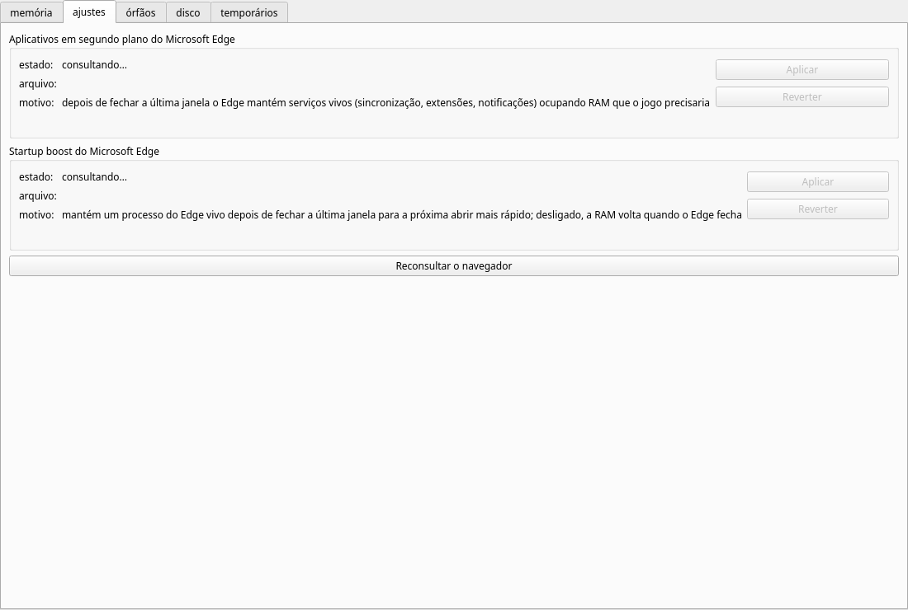
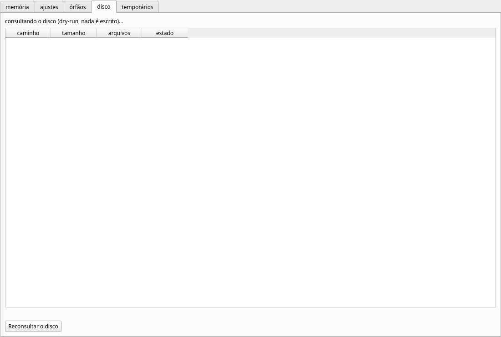
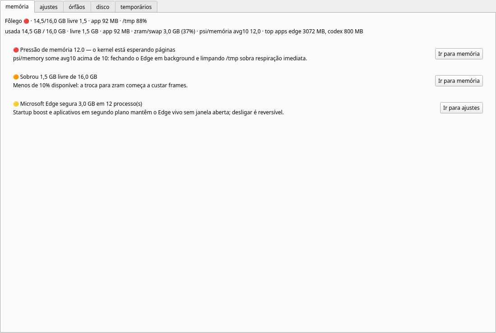
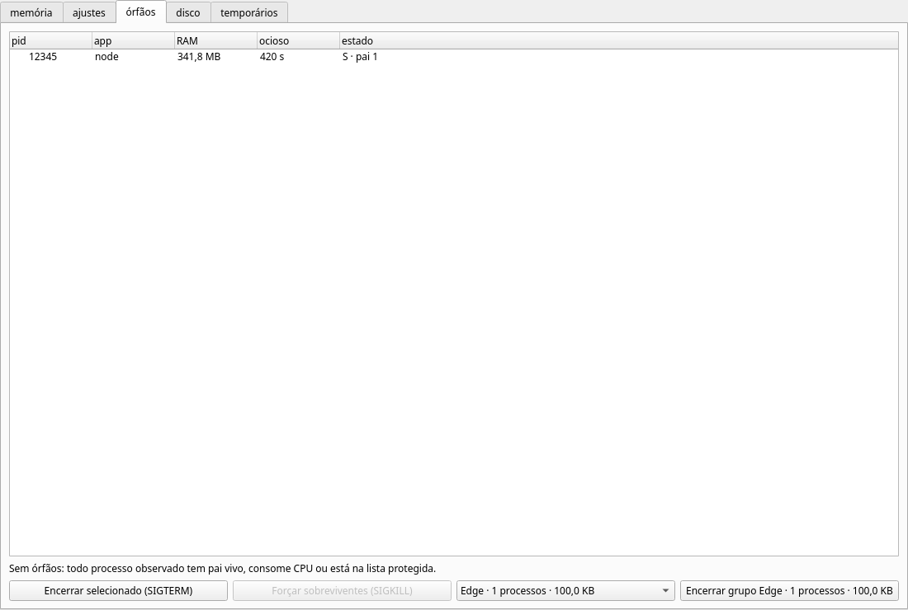
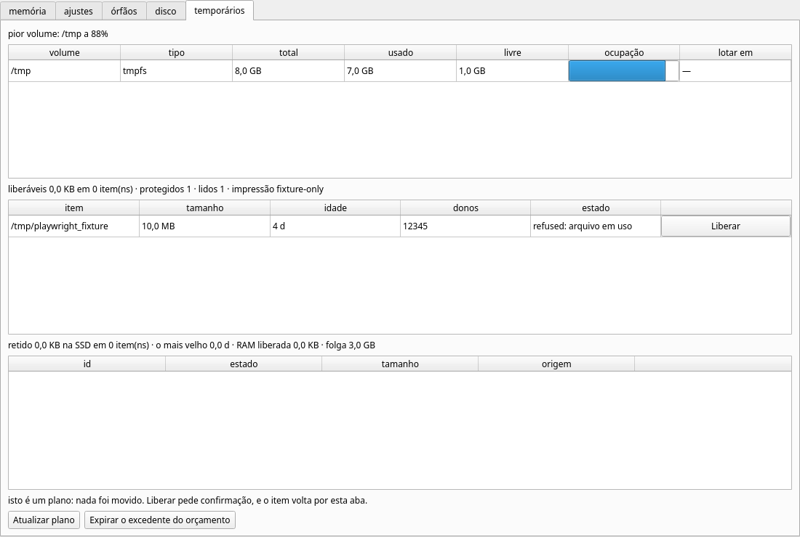
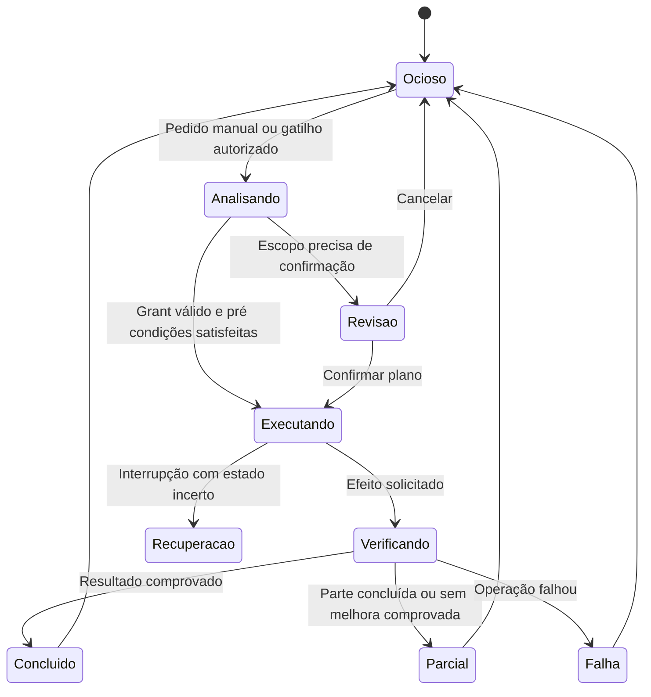

# Experiência e proposta visual do Fôlego

O produto deve responder rapidamente a três perguntas: **como está meu host, o que o Fôlego pode fazer agora e o que ele fez**. A proposta substitui a organização centrada em mecanismos técnicos por uma visão de saúde, recomendações e ações compreensíveis, mantendo detalhes avançados disponíveis.

A direção recomendada é uma interface desktop sóbria, com hierarquia clara, acento verde-água e movimento discreto. O modo compacto deve ser útil sem disputar atenção ou consumir continuamente os recursos que pretende economizar.

## Evidência da experiência atual

As imagens abaixo foram renderizadas nesta revisão a partir dos widgets atuais, em 1100 × 740, usando Qt offscreen e fixtures. Não são mockups do novo design nem capturas do host sob carga. A sequência compara cinco superfícies; não demonstra uma sessão completa de limpeza. Não houve acesso a uma ferramenta de controle/captura do desktop nativo para validar o fluxo real no compositor. Por isso, esta é uma revisão de interface por código e renderização controlada, não uma auditoria completa de uso em KDE.

### Passo 1 Abrir ajustes

**Saúde do passo: atenção.** O agrupamento dos ajustes é compreensível, e Aplicar/Reverter começam desabilitados. Porém, “consultando…” aparece sem uma consulta em andamento: `refresh` depende do botão. “Reconsultar” também pressupõe uma primeira leitura que não ocorreu. Os textos explicativos têm o mesmo peso visual dos estados e, sem quebra adequada em todos os labels, pressionam a largura da janela.

Proposta: estado inicial “Ainda não analisado”, ou consulta leve automática ao entrar na seção. Texto do ajuste em linguagem de efeito, status visível e detalhes do arquivo numa expansão. A confirmação deve informar o impacto, a condição de navegador fechado e o backup disponível.

### Passo 2 Abrir disco

**Saúde do passo: atenção.** A tabela é simples e a consulta é explícita. Entretanto, “consultando o disco” também não corresponde ao início efetivo de um job. Não existe resumo dos volumes, progresso real, cancelar ou ação gráfica para concluir a limpeza; após planejar, o usuário é encaminhado ao terminal.

Proposta: apresentar capacidade por volume e “Analisar espaço”. Depois, seleção por categoria/risco, revisão dos alvos e operação pela própria interface. Diferenciar mover para quarentena de liberar capacidade por exclusão. Caminho completo fica em detalhe copiável, sem determinar a largura de toda a tabela.

### Passo 3 Ler memória sob alerta simulado

**Saúde do passo: atenção.** A aplicação informa razões e números, mas os dados estão concentrados em linhas longas e as sugestões usam pouco a área disponível. Dois botões “Ir para memória” levam à própria aba, sem resolver o alerta. “Livre” representa `MemAvailable`, enquanto “GB” é calculado em base 1024; o texto precisa distinguir disponibilidade e padronizar unidades.

Proposta: cabeçalho “Memória sob pressão”, resumo em linguagem comum, indicadores independentes para memória/CPU/disco/temporários e uma lista curta de ações efetivamente possíveis. A recomendação deve levar ao recurso ou à ação correspondente. Evitar prometer que fechar um navegador específico sempre resolve a pressão.

### Passo 4 Inspecionar processos simulados

**Saúde do passo: requer correção.** A tabela informa PID, RAM e tempo observado, mas a barra inferior é dominada por ações de encerramento e linguagem SIGTERM/SIGKILL. A captura contém um candidato enquanto o rodapé ainda diz “Sem órfãos”; o texto não é atualizado quando surgem linhas. O usuário não recebe identidade da sessão/projeto nem evidência suficiente para decidir.

Proposta: seção “Processos e sessões”, agrupamento por projeto e procedência, rótulo “Possivelmente abandonado” e justificativa. A ação primária abre detalhes ou solicita encerramento gracioso; “Forçar encerramento” é secundária e contextual. Explicar sinais em detalhe técnico, não como vocabulário obrigatório do fluxo principal.

### Passo 5 Revisar temporários simulados

**Saúde do passo: requer correção.** As tabelas tornam volume, inventário e retenção acessíveis numa mesma tela. Porém, todas as colunas recebem a mesma proporção, caminhos e motivos competem por espaço, e há botão “Liberar” habilitado para um item protegido por arquivo em uso. O orçamento mistura retenção em disco e “RAM liberada” histórica, dando uma impressão excessiva de resultado medido.

Proposta: resumo de capacidade no topo; abas internas “Recomendações”, “Protegidos” e “Retenção”; motivos claros junto a ações desabilitadas. Mostrar resultado observado separadamente do volume transferido. Expiração abre lista concreta do que será removido, com risco de irreversibilidade e data limite de recuperação.

## Arquitetura da informação proposta

| Área | Conteúdo principal | Ação principal |
|---|---|---|
| Visão geral | Estado do host, qualidade da coleta, quatro recursos, recomendações e última operação | Dar fôlego |
| Processos e sessões | Sessões administradas, projetos, consumo, processos sem procedência | Revisar sessão |
| Armazenamento | Volumes, inodes, temporários, caches e árvores cadastradas | Analisar espaço |
| Ambientes virtuais | Containers, VMs, imagens, volumes e dependências | Inspecionar ambiente |
| Histórico e recuperação | Operações, efeitos, erros, quarentena, backups e restore | Ver resultado / Restaurar |
| Preferências | Modo, preset, permissões, exclusões, aparência e limites do app | Salvar configuração |

Não criar seis painéis vazios na primeira entrega. Áreas sem adaptadores instalados explicam a disponibilidade; recursos ainda não implementados não aparecem como funcionais. A seção atual de ajustes do Edge pode entrar em recomendações e numa subseção de configurações de aplicativos.

Na janela completa, navegação lateral de aproximadamente 200 px em telas amplas. Em 800 × 600, usar navegação compacta e conteúdo rolável; não depender de uma largura mínima maior que a tela. Em 1280 × 800 e acima, usar quatro indicadores em linha ou grade 2 × 2, seguida de recomendações e atividade recente. O espaço em branco separa assuntos; não substitui informação de estado.

## Direção estética

Proposta de tokens iniciais, a validar com contraste calculado e inspeção em temas claro/escuro:

| Token | Escuro | Claro | Uso |
|---|---|---|---|
| Fundo | `#10151D` | `#F4F7FA` | Janela e fundo do painel |
| Superfície | `#19212C` | `#FFFFFF` | Cards e popover |
| Borda | `#344254` | `#CCD6E1` | Separação e contornos |
| Texto principal | `#F1F5FA` | `#172435` | Títulos, valores, botões |
| Texto secundário | `#B3C0D0` | `#4D6075` | Explicações e metadados |
| Acento | `#57D6BD` | `#087B67` | Ação primária e foco |
| Atenção | `#F6C56D` | `#8A5800` | Estado que merece observação |
| Crítico | `#FF8E99` | `#B6293B` | Problema confirmado |

Tipografia: fonte da plataforma, preferindo Noto Sans quando disponível. Corpo 14–16 px equivalentes, títulos 22–28, números principais 26–32 com alinhamento tabular. Escala de espaços 4/8/12/16/24/32. Cantos de 12 px em cards e 16 px no popover, evitando arredondamento excessivo em tabelas. Ícones consistentes do tema Qt ou biblioteca licenciada; substituir emojis como único indicador.

Temas seguem a preferência do sistema e podem ser fixados pelo usuário. Evitar blur extenso, sombras animadas e transparência que reduza legibilidade. Usar superfícies opacas e contornos perceptíveis. Um ícone de estado deve vir acompanhado de palavra e descrição, nunca só cor.

## Controle flutuante

Três superfícies complementares:

1. **Controle compacto:** botão de 64–72 px lógicos, com opção de cápsula que inclui “Normal”, “Atenção” ou “Crítico”. Uma marca pequena informa Manual/Auto/Pausado.
2. **Painel rápido:** aproximadamente 340–380 px de largura, ajustável ao espaço disponível. Mostra estado, causa principal, modo, preset, oportunidade elegível e ação “Dar fôlego”.
3. **Central completa:** diagnóstico, revisão de itens, histórico, permissões e recuperação.

No primeiro uso, um clique no controle abre o painel rápido. Dentro dele, o usuário escolhe modo/preset e vê o escopo. Após habilitar explicitamente “Ação rápida com este preset”, o clique principal pode executar somente o escopo autorizado; um controle secundário visível e o menu de contexto mantêm acesso aos detalhes. A preferência deve ser explicada com uma prévia do próximo clique. Não depender exclusivamente do botão direito ou de hover.

Arrastar usa um limiar de movimento e nunca executa a ação ao soltar. Uma ação em andamento desabilita novo disparo e preserva acesso ao progresso/cancelamento. Ocultar o controle é diferente de pausar automático. “Sair do Fôlego” informa que encerra monitoramento; fechar a central pode manter o residente, com indicação clara.

### Estados e animações

Saúde, modo e operação são eixos diferentes. Um host pode estar crítico enquanto uma operação concluiu parcialmente; o botão não pode esconder uma dessas informações.

| Estado da operação | Apresentação | Comportamento |
|---|---|---|
| Ocioso | Ícone estático e status atual | Sem animação permanente por padrão |
| Analisando | Arco discreto e “Analisando” | Progresso indeterminado quando não há total confiável |
| Aguardando revisão | Símbolo e “Revisar ações” | Abre plano; não sugere que já limpou |
| Executando | Arco e etapa real, por exemplo “2 de 4” | Não inventar percentuais com timer |
| Verificando | “Conferindo resultado” | Consulta efeito real antes de sucesso |
| Concluído | Confirmação breve, 0,8–1,2 s | Depois volta a exibir saúde atual e resumo |
| Parcial | Indicador de atenção e “Ver resultado” | Mostra feitos, recusados e recuperação |
| Falha | Erro legível e opção de detalhes | Não repetir automaticamente nem elevar risco |
| Sem dados | Estado neutro e idade da última leitura | Bloqueia ações dependentes da telemetria |

Transições de painel/hover entre 150 e 220 ms. Animação de execução limitada, inicialmente 20–30 fps, sem efeitos de partículas ou repintura da tela inteira. “Respiração” ornamental é opcional, curta e desativada em economia de energia; não é requisito para a marca. Preferência de reduzir movimento troca animações por alterações instantâneas e texto. Toda animação cessa ao ocultar a superfície.

### Compatibilidade do desktop

Qt documenta que o posicionamento programático de janelas de topo normalmente não é suportado pelo shell padrão de Wayland. O design não deve prometer que `move()` coloca e persiste o botão num canto em toda sessão. Usar movimentação iniciada pelo sistema, testar flags por compositor e detectar capacidades. [Janelas Qt e Wayland](https://doc.qt.io/qt-6/application-windows.html), [QWindow](https://doc.qt.io/qt-6/qwindow.html).

Em X11, testar posição, escala e sempre-no-topo. Em KDE/Wayland, testar arraste, tela cheia, troca de monitor e regras do compositor. Se o comportamento desejado exigir integração específica, oferecer bandeja + painel compacto como alternativa suportada; considerar um widget Plasma em fase posterior. Não forçar XWayland sem uma escolha informada. O botão não deve roubar foco ao atualizar métricas ou aparecer sobre uma apresentação sem configuração do usuário.

Recalcular geometria ao desconectar monitor, mudar escala ou rotacionar a tela; nenhuma preferência salva pode deixar o controle inacessível. A bandeja também pode ser ocultada pelo ambiente, portanto a central deve continuar acessível por launcher e, onde suportado, atalho configurável.

## Fluxos essenciais

### Primeiro uso

Abrir → explicar em uma frase o propósito → mostrar diagnóstico → modo Manual selecionado → escolher preset → revisar permissões apenas se habilitar automático ou ação rápida. Não solicitar root ou integração com todos os agentes para obter valor inicial.

### Dar fôlego manualmente

Abrir painel rápido → “Dar fôlego” → analisar → apresentar itens, impacto, limite e reversibilidade → confirmar → acompanhar etapas → verificar → exibir resultado e acesso a restore. Se houver grant de ação rápida, pular apenas a confirmação já coberta pelo grant. Se não houver ação elegível, mostrar “Nenhuma ação segura disponível”, com a causa do alerta e alternativas manuais.

### Automático

Ativar após revisar o escopo → observar estado “Auto · Conservador” → gatilho sustentado → operação autorizada → resumo discreto. “Pausar por 1 h”, “Pausar até retomar” e “Rever permissões” ficam no painel rápido. Mudança de preset com mais permissões volta à revisão; a seleção visual não basta como consentimento.

### Resultado e recuperação

Exemplo de texto: “2 ações concluídas; 1 item preservado porque continua em uso. 420 MiB transferidos de /tmp; 420 MiB retidos no disco. Disponibilidade de /tmp aumentou 418 MiB durante a operação.” Números do exemplo são fictícios. Não usar “Seu computador ficou 35% mais rápido” sem uma medição específica que sustente isso.

Histórico traz momento, ator, preset, alvo, efeito observado, recusas e capacidade de desfazer. “Restaurar” aparece só onde aplicável; encerramento de processo não tem botão enganoso de desfazer. Estado parcial abre recuperação antes de tentar limpar novamente.

## Acessibilidade e critérios visuais

- Controles principais com alvo de pelo menos 44 × 44 px lógicos; tamanho ampliável no modo compacto.
- Teclado: ordem de foco previsível, Enter/Espaço acionam controles, Escape fecha painel, foco retorna ao acionador.
- Nomes e descrições acessíveis em widgets customizados; status anunciado sem repetir cada amostra.
- Cor, ícone e texto redundantes. Contraste de texto normal alvo ≥4,5:1 e de controles/estados ≥3:1, a medir na implementação.
- Suporte a escala 100%, 150%, 200%, alto contraste e movimento reduzido; nenhuma informação essencial depende de animação.
- Tabelas com cabeçalhos claros, seleção preservada por identidade, detalhes copiáveis e motivo de bloqueio acessível.
- Notificações agrupadas, com intervalo mínimo e modo silencioso; mudança de número sem mudança de gravidade não gera alerta novo.

Os screenshots atuais não demonstram navegação por teclado, leitura assistiva, contraste calculado, DPI real, bandeja ou foco no compositor. Esses itens entram no aceite de F4/F5. Esta proposta especifica o design e a interação; não apresenta um protótipo novo como se já estivesse implementado.
