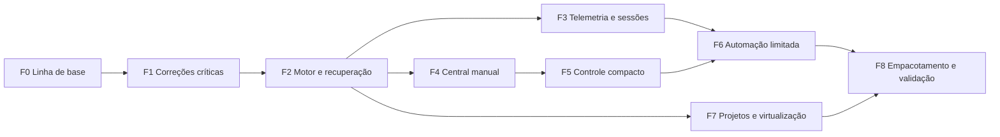

# Plano de ação para evoluir o Fôlego

A implementação deve entregar incrementos utilizáveis sem ligar automação antes de resolver suas pré-condições. As etapas abaixo combinam robustez e experiência: corrigir riscos, estabelecer o motor comum, redesenhar o fluxo manual e então ampliar a autonomia e os adaptadores.

Os IDs R01–R20 referem-se à [avaliação técnica](01-avaliacao-tecnica.md). As etapas são dimensionadas por entregáveis e critérios de aceite, sem prometer datas antes de medir o esforço real. Responsabilidades sugeridas são papéis; não pressupõem uma equipe de várias pessoas.

## Sequência e dependências

F3 e F4 podem avançar de forma independente depois dos contratos de F2; isso é uma possibilidade de organização do trabalho, não uma autorização para iniciar agentes adicionais. F7 começa com inventário; mutações de VMs e containers não bloqueiam a primeira versão do controle compacto.

## F0 Consolidar linha de base e decisões

**Prioridade P0 · papel responsável: engenharia do núcleo.**

Entregas:

- Registrar commit, Python/PySide/Qt, comandos reproduzíveis e baseline da suíte.
- Transformar os sete diagnósticos em testes de regressão nos módulos correspondentes, afirmando o comportamento correto desejado.
- Corrigir a premissa ambiental do teste de destino “SSD”: validar capacidade/montagem, não prefixo do diretório de pytest.
- Registrar decisão de manter Python/Qt, CLI headless e prioridade Linux/KDE; separar o que é proposta do que é medido.
- Criar README de desenvolvimento e inventário de funcionalidades; marcar T14 do plano M7 como pendente no checkout, sem anunciar conclusão inexistente.

**Aceite:** testes novos reproduzem falhas antes das correções; suíte existente preservada; ambiente de testes não depende da home nem de temporários do host serem SSD. Nenhum teste pode tocar em dados reais para provar limpeza.

## F1 Corrigir caminhos de risco e falhas de interface

**Prioridade P0/P1 · depende de F0 · papéis: núcleo e interface.**

| Tarefa | Arquivos iniciais | Critério de aceite |
|---|---|---|
| F1.1 Confinar limpeza legada | `cli.py`, `actions/disk/tmpclean.py` | Raiz arbitrária, descendente recente, montagem e item em uso são recusados; rota insegura fica sem mutação até unificação |
| F1.2 Preservar qualidade do inventário | `tmpfs/holders.py`, `inventory.py`, `policy.py`, `disk/planner.py` | Leitura desconhecida/parcial bloqueia elegibilidade; erros chegam à UI/JSON |
| F1.3 Resolver retenção ativa corretamente | `tmpfs/ledger.py`, `release.py` | Múltiplos ciclos no mesmo caminho não ignoram registro ativo |
| F1.4 Finalizar todos os jobs | `ui/tune_jobs.py`, `process/runner.py` | Falha de início/timeout/cancelamento libera estado uma vez; callback único; objetos concluídos descartados |
| F1.5 Corrigir listas e ações | `ui/orphans_panel.py`, `ui/tmpfs_tab.py` | Alteração de grupos não lança erro; estado textual atualizado; item protegido não oferece execução |
| F1.6 Corrigir mensagens e retorno | `core/suggestions.py`, `cli.py`, UI | “Possível abandono”, “sinal enviado”, resultado parcial e bytes corretos; ausência de dados não vira sucesso |
| F1.7 Proteger apply e revert | `tunings/worker.py`, `engine.py`, `safely/backup.py` | Mesma confirmação em entradas diretas; navegador aberto bloqueia ambas; backup privado e verificável |
| F1.8 Robustecer parsers | `core/procfs.py`, `sysfs.py` | Processo que desaparece não invalida snapshot; campos malformados degradam; zram segue ABI real |

**Aceite da etapa:** nenhuma regressão dos testes existentes; novos testes de R01–R07 passam; o modo continua manual. Riscos de transação e corrida ainda não resolvidos permanecem bloqueados para automação e explicitamente descritos.

## F2 Unificar planejamento, execução e recuperação

**Prioridade P0 · depende de F1 · papel: núcleo e persistência.**

Entregas em pequenas mudanças revisáveis:

1. Modelos `ResourceIdentity`, `ActionPlan`, `ActionResult`, `Grant` e `OperationState` independentes de Qt. Serialização versionada e validação de entrada.
2. Coordenador único com trava interprocessos, fila limitada, idempotência e suporte a GUI/CLI. Migrar todas as mutações, inclusive reaper e restore, sem manter uma rota alternativa mais permissiva.
3. Política unificada de caminhos, mounts, identidades, alvos protegidos, completude e revalidação. Não usar apenas `realpath` e flags de confirmação como prova de segurança.
4. Diário de intenção, staging, reservas e recuperação. Registrar antes de copiar; verificar dados e durabilidade antes de remover a origem; tratar todos os pontos de interrupção.
5. Persistência transacional e migração de JSONL/manifests com backup, versionamento e relatório de entradas inconsistentes.
6. Verificação de destino persistente, folga por volume e cota conjunta de retenção/staging. Contabilidade separa bytes lógicos, alocados, transferidos e observados.
7. Protocolo consistente de resultado em JSON inclusive para recusa, erro, parcial e timeout; códigos de saída documentados.
8. Identidade de processo estável, revalidação completa, acompanhamento de SIGTERM e política explícita de escalada manual.

**Aceite:** duas CLIs e a GUI não podem mutar simultaneamente o mesmo estado; encerramento do controlador em cada transição permite recuperação sem perda silenciosa; plano expirado, alvo trocado, estado corrompido e grant inválido são recusados. Resultado de uma operação repetida é consultado, não reaplicado.

F2 resolve R08–R15, R17 e o contrato comum de R18/R20. Algumas proteções, como árvore externa que pode continuar recebendo escrita, podem ser satisfeitas pela recusa de automação; não exigir uma garantia impossível por observação de fd.

## F3 Melhorar diagnóstico e administrar sessões

**Prioridade P1 · depende de F2 · papel: telemetria e integrações locais.**

Entregas:

- Snapshot com relógio monotônico, timestamp humano, idade e qualidade por fonte.
- CPU por deltas, PSI some/full onde válido, zram correto, bytes/inodes por volume e I/O básico. RSS identificado como estimativa; PSS sob demanda.
- `HealthEngine` independente de Qt, histerese, reasons e thresholds versionados.
- Coleta limitada e desacoplada do trabalho pesado; modelos de UI atualizados por diferença.
- Registro opt-in de sessões e artefatos; launcher/API local com UUID e política de vida útil.
- Integração experimental com unidades de usuário/cgroups, apenas quando capacidades e permissões forem comprovadas. Sessões persistentes, desconexão e heartbeat perdido têm estados distintos.
- Lista de exclusões por identidade de aplicação/projeto e opção “manter ativo”.

**Aceite:** dados ausentes ou antigos não autorizam ações; dois reboots ou reuso de PID não confundem sessões; um agente que perde conexão mas deixa build útil ativo não é encerrado por heurística; processo abandonado consumindo CPU aparece como investigação possível mesmo sem satisfazer a regra antiga de ociosidade.

## F4 Redesenhar a central e concluir o fluxo manual

**Prioridade P1 · depende de F2 · papel: interface e experiência.**

Entregas:

- Tokens de tema, tipografia, espaçamento, ícones, foco e mensagens consistentes conforme a proposta visual.
- Visão geral com saúde por recurso, qualidade da coleta, recomendações acionáveis e última operação.
- Seções de processos/sessões, armazenamento e histórico/recuperação. Ajustes existentes integrados sem perder funcionalidades.
- Componentes de revisão de plano: seleção, risco, efeitos, retenção, exclusões e confirmação concreta.
- Execução manual pela GUI sem exigir terminal para concluir o fluxo de disco.
- Estados vazios, ainda não analisado, carregando, parcial, recusado e erro reais; não mostrar “consultando” sem job.
- Histórico com restore somente quando válido; detalhes técnicos progressivos e exportação sanitizada.

**Aceite:** fluxo analisar → revisar → executar → verificar → consultar resultado → restaurar funciona integralmente com fixtures e operações sintéticas. Testar 800 × 600, 1280 × 800, 1920 × 1080, escalas 100/150/200%, teclado e movimento reduzido. Medir contraste; verificar foco e nomes acessíveis dos componentes customizados.

## F5 Entregar controle compacto e bandeja

**Prioridade P1 · depende de F4 · papel: desktop Qt.**

Entregas:

- Controle flutuante/cápsula, painel rápido, atalho quando suportado e integração com a central.
- Estados reais do motor com animações limitadas; saúde, modo e operação visualmente distintos.
- Preferência opcional de ação rápida com grant limitado e acesso permanente a detalhes.
- Arraste sem execução, proteção contra clique duplicado, posição recuperável e comportamento em múltiplos monitores.
- Matriz de capacidades X11/Wayland; alternativa bandeja + janela compacta quando posicionamento/topmost não for suportado.
- Fechar/ocultar/pausar/sair com semânticas distintas. Tratamento de bandeja indisponível e de ausência do monitor salvo.

**Aceite:** cliques repetidos geram uma operação; arraste gera zero; feedback só celebra resultado comprovado; uma operação concluída não apaga um alerta persistente. Verificação real no compositor registra foco, tela cheia, posição, DPI, hotplug e retorno ao launcher. Testes offscreen não substituem essa verificação.

## F6 Habilitar presets e automação limitada

**Prioridade P1 · depende de F2, F3 e F5 · papéis: política e experiência.**

Entregas:

- Modos Manual, Assistido e Automático separados de presets Conservador, Equilibrado, Foco, Manutenção e Personalizado.
- Grants persistidos e revogáveis, com escopo, limites e versão; expansão de autorização exige revisão.
- Gatilhos sustentados, aquecimento, histerese, intervalo mínimo, limites por hora e disjuntor por falha.
- Primeira automação restrita a temporários/sessões administrados com propriedade comprovada. Processos descobertos e discos virtuais continuam manuais.
- Modo de simulação que registra “executaria” sem produzir efeitos; comparar decisões com revisão humana antes de ligar execução real.
- Pausa, agendamento consentido, exclusões e registro do ator automático em todas as ações.

**Aceite:** testes provam que trocar preset não amplia grant; telemetria stale suspende ação; reboot/resume revalida; orçamento esgotado impede cópia; falha não provoca escalada; recursos desconhecidos ficam preservados. Operações automáticas reais só entram após simulação e validação em ambiente descartável.

## F7 Ampliar projetos, caches e ambientes virtuais

**Prioridade P2 · depende de F2 e contratos de F3 · papel: adaptadores.**

Implementar cada adaptador em duas entregas: inventário/diagnóstico e, depois, ações limitadas. Uma interface comum retorna disponibilidade, evidências, itens protegidos, plano e resultado.

| Adaptador | Primeiro valor | Condição para permitir ação |
|---|---|---|
| Projetos e Git | Projetos cadastrados, worktrees, artefatos e custo por sessão | Trabalho não salvo, locks e vínculos verificados; descarte declarado |
| Caches | Tamanho, regenerabilidade, idade e custo estimado de reconstrução | Ferramenta/versão suportada, exclusões e ausência de uso compatíveis |
| Docker/Podman | Contexto, containers, imagens, volumes, build cache | Escopo exato por IDs/labels e referências; sem prune global automático |
| libvirt | VMs, discos, snapshots, backing chains e consumo | Operação via gerenciador, identidade estável e plano específico |
| Montagens e imagens externas | Inventário de volumes, tipo e identidade | Revisão manual; nenhum unmount ou exclusão por extensão/idade |

**Aceite:** ausência da ferramenta não quebra o app; contexts/URIs não se misturam; volume usado por container parado é preservado sem autorização específica; base qcow2 referenciada é protegida; VM pausada não é reportada como RAM liberada. Ações privilegiadas ficam fora do primeiro ciclo de entrega.

## F8 Preparar distribuição e validar operação prolongada

**Prioridade P1 · integra entregas anteriores · papéis: empacotamento e validação.**

Entregas:

- Dependências/versões suportadas, entrypoint `folego`, instalação reproduzível, launcher desktop e documentação de remoção preservando dados.
- `doctor` somente leitura: capacidades, diretórios, versão de schema, permissões, backend gráfico e dependências opcionais.
- Instância única e autostart opcional, com monitoramento ativo claramente indicado.
- CI para testes puros, Qt offscreen e integração isolada; nenhuma suite depende de aplicações reais do usuário.
- Migração de estado DeckWellness/Fôlego, rollback da aplicação e manutenção dos backups.
- Rotação de logs, compactação, budgets e testes prolongados sem crescimento contínuo de QProcess/widgets/registros em memória.
- Guia de diagnóstico, recuperação após interrupção e limites de cada integração.

**Aceite:** instalar num ambiente Linux limpo conforme o suporte declarado; abrir GUI e CLI; migrar fixture antiga sem perdas; executar ensaio prolongado com carga sintética e medir consumo. Verificar ausência de processos próprios esquecidos após cancelamento/saída, registrando separadamente a exceção de estado D.

## Matriz obrigatória de validação

| Dimensão | Cenários | Resultado esperado |
|---|---|---|
| Segurança de dados | Links, troca de inode, mount inserido, bind mount, descendente recente, holder desconhecido | Recusa explícita, nenhuma perda de conteúdo |
| Interrupção | Encerrar worker antes/durante/depois de copiar, auditar e remover; ENOSPC; EACCES | Estado recuperável; origem ou cópia certificada preservada |
| Concorrência | GUI + duas CLIs; duas instâncias; duplo clique; grant alterado em voo | Uma autoridade de mutação; alvo/consentimento revalidados |
| Processos | PID reutilizado, exec no mesmo PID, filhos novos, TERM ignorado, sessão persistente | Identidade estável; término só reportado quando observado |
| Telemetria | `/proc` parcial, processo desaparecendo, PSI ausente, clocks alterados, resume | Snapshot parcial identificado; nenhuma conclusão falsa de segurança |
| Contabilidade | Sparse, hardlinks, clone ausente, rename na mesma partição, tmpfs em swap | Sem somar economia fictícia; estimativa e observação distintas |
| Automação | Threshold oscilando, grant vencido, quota, desconhecido, duas falhas | Histerese, recusa, intervalo mínimo e pausa automática |
| Desktop | X11, KDE/Wayland, sem tray, fullscreen, hotplug, DPI | Controle acessível, sem roubar foco, alternativa funcional |
| Acessibilidade | Teclado, leitor de tela compatível, alto contraste, movimento reduzido | Ação e status compreensíveis sem cor/hover/animação |
| Eficiência | Muitos processos, árvore enorme, refresh repetido, janela oculta, longa duração | Limites respeitados, UI responsiva, sem retenção ilimitada |

Os testes de adversidade usam fixtures, namespaces/ambientes descartáveis quando necessários e processos pertencentes ao ensaio. Não instalar VMs, encher disco/RAM ou encerrar tarefas do usuário para demonstrar eficácia.

## Métricas de sucesso

Definir denominadores e condições de medição antes de divulgar números:

- Taxa de ações elegíveis que concluem, recusam ou exigem recuperação, por adaptador e versão.
- Ações indevidas em recursos protegidos: zero no corpus de validação; qualquer ocorrência bloqueia lançamento da automação.
- Bytes candidatos, transferidos, retidos e disponibilidade observada por volume; não somar categorias diferentes.
- Tempo e CPU/I/O de cada operação; custo de reconstrução de caches quando mensurável.
- Latência p95 da UI e custo do residente nos estados compacto, aberto, oculto e executando.
- Tempo para recuperar operação interrompida e consistência de referências/retention após migração.
- Facilidade do fluxo: o usuário identifica estado, motivo e ação, executa e encontra o resultado sem abrir terminal.

Metas iniciais de desempenho estão em [Arquitetura e presets](02-arquitetura-e-presets.md). Devem ser ajustadas com evidência do hardware, sem reduzir proteções para alcançar um número.

## Condição de conclusão por incremento

Cada incremento entrega código, testes proporcionais ao risco, evidência reproduzível, atualização da documentação e lista de limites remanescentes. Recursos incompletos ficam indisponíveis ou explicitamente experimentais. Não considerar um placeholder, JSON simulado ou botão sem integração como implementação concluída.
